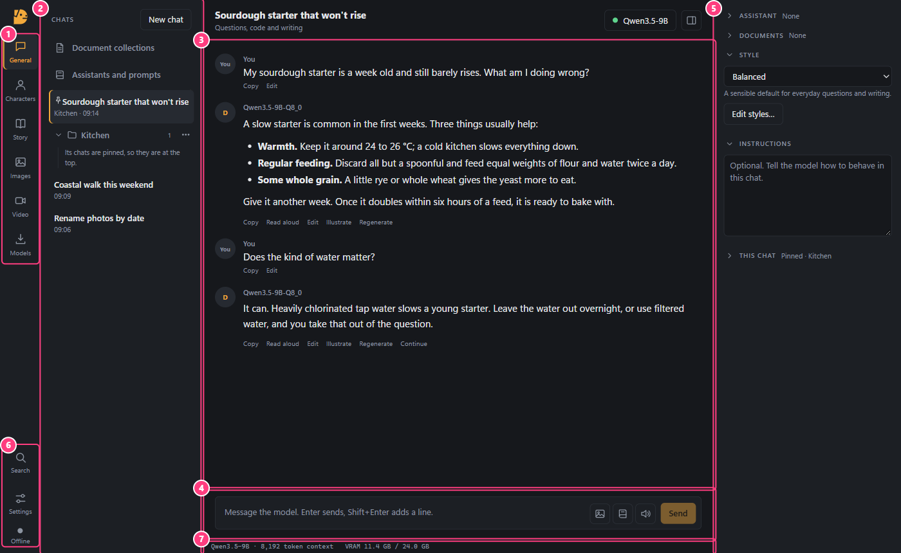

# DOG.ai

A private Windows app for running language, picture and video models on your own PC. It works offline: it goes online
only when you switch that on in the Models section, and then only to Hugging Face and GitHub to download models and
engines. Your chats, characters, stories, pictures and clips never leave your PC.



## What it does

- **General chat** with local models: folders, search, assistants and a prompt library, and pictures in a question for
  models that can see.
- **Characters:** character cards (import and export), personas, lore, memory and group chats.
- **Stories:** interactive adventures with choices, and written stories along an outline, with a branch map and exports.
- **Documents:** ask about your own PDFs, Word files and text, with citations.
- **Images:** make pictures from a prompt, keep them, upscale them, with helpers that write and check the prompt.
  Portraits for characters and pictures for stories and chats too.
- **Video:** five-second clips from a sentence or a picture, continued and joined into longer ones.
- **Voice:** talk to it, hands-free if you like, and have replies read aloud with a voice per character.
- **Models:** recommended models judged against your PC, Hugging Face search, downloads, and the engines that run them.
- **Locked data:** the database can be encrypted with a password, with Windows Hello to unlock day to day, and backed up.
- **Portable:** the app, its data and its models live in one folder you can move anywhere.

## Quick start

1. Download `DOG.ai-win-x64.zip` from [Releases](https://github.com/Carpe-Canem/DOG.ai/releases), unblock it
   (right-click, Properties, Unblock), and unzip it wherever you like.
2. Start `DOG.ai.exe`.
3. In **Models** › **Engines**, press **Go online**, then **Check for updates** and **Install**.
4. In **Models** › **Get models**, download a recommended model, and make it the **General** default under
   **On this PC**.
5. Open **General** and ask something.

The [install page](docs/guide/install.md) has every step with pictures.

## The guide

[The user guide](docs/guide/README.md) has a page for each part of DOG.ai.

## Building

Needs Windows 10 or 11 and the .NET 9 SDK.

```
dotnet build DogAI.sln
dotnet test DogAI.sln
dotnet publish src/DogAI.App -p:PublishProfile=win-x64
```

The publish step writes the portable folder to `publish\win-x64`. Chat models run through
[llama.cpp](https://github.com/ggml-org/llama.cpp)'s `llama-server`, pictures and clips through
[stable-diffusion.cpp](https://github.com/leejet/stable-diffusion.cpp); DOG.ai starts and stops both, and they are
reachable only on this PC. The window is WPF hosting a Blazor Hybrid interface on .NET 9.

| Folder | What is in it |
|---|---|
| `src/DogAI.App` | The window, start-up and Windows integration |
| `src/DogAI.UI` | Pages, components and styles |
| `src/DogAI.Core` | The app's logic, with no UI or I/O |
| `src/DogAI.Engine` | Running the model engines |
| `src/DogAI.Data` | The SQLite database |
| `src/DogAI.Hub` | The only code that goes online |
| `tests/DogAI.Tests` | Tests |
| `tools` | Scripts for checking the app and making the guide's pictures |

- [`docs/PLAN.md`](docs/PLAN.md): the plan, what is done, and what has and has not been checked.
- [`CLAUDE.md`](CLAUDE.md): how the code is laid out and the rules it keeps to.
