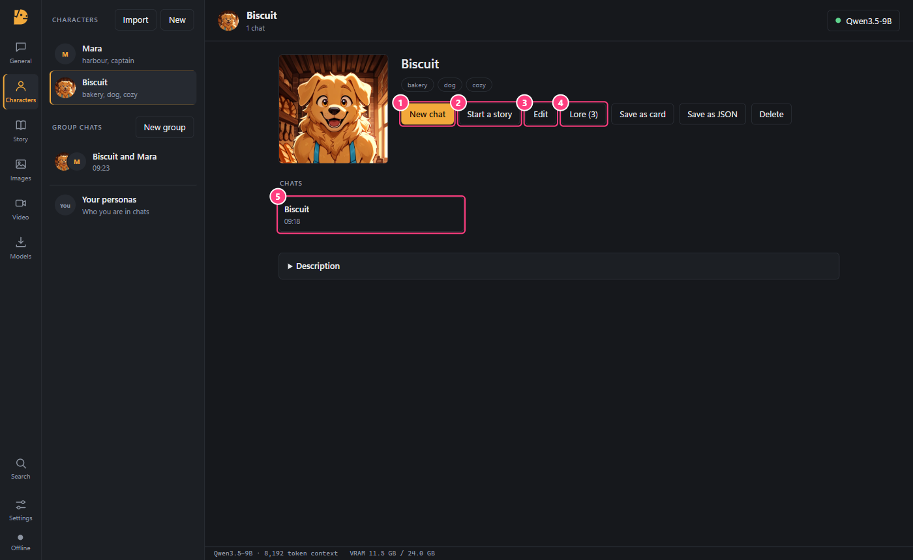
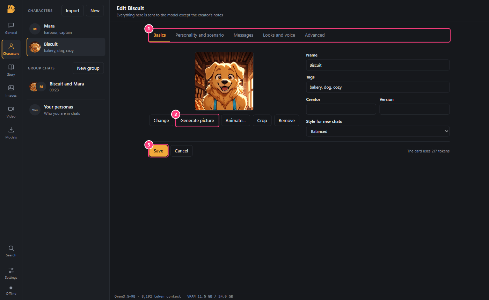
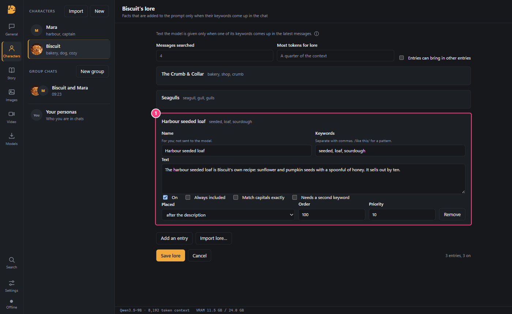
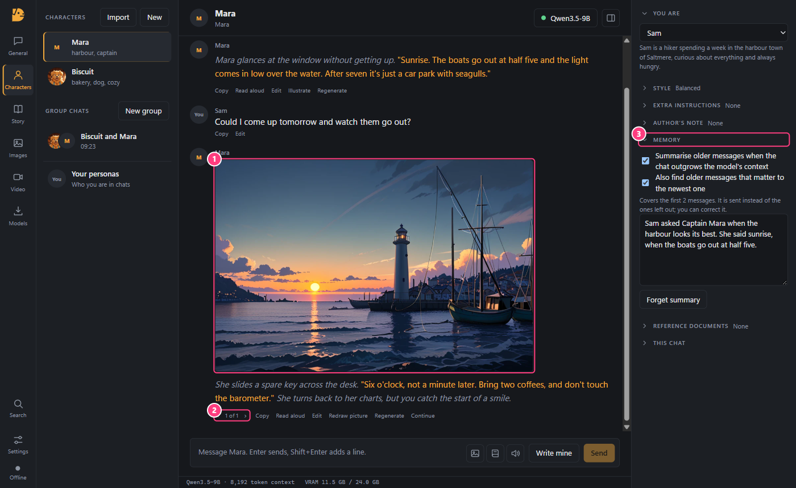
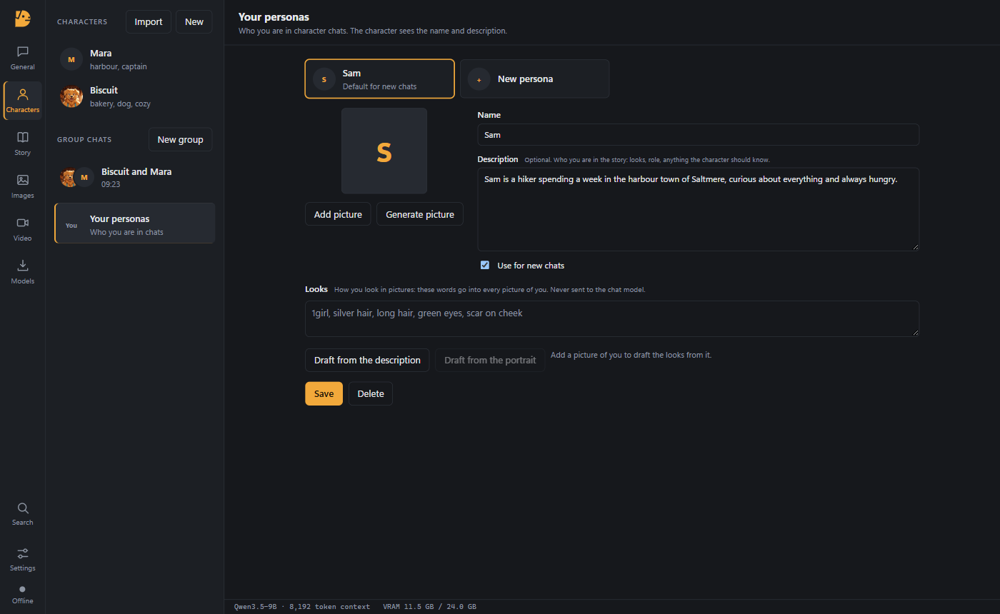
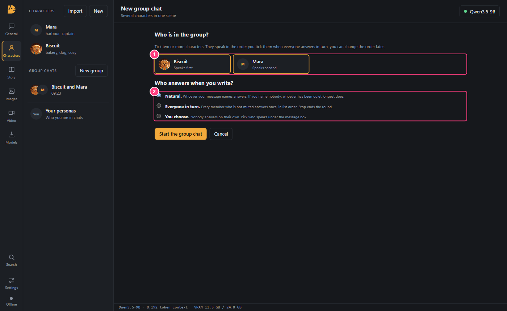
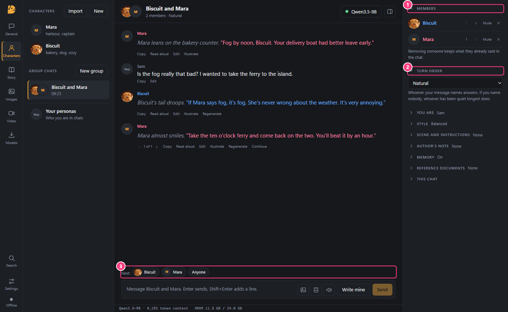

<!-- covers: characters, characters/new, characters/group/new, characters/personas -->
<!-- sources: src/DogAI.UI/Pages/{Characters,CharacterEditor,GroupChat,Personas,LoreEditor}.razor, src/DogAI.UI/Components/Characters/**, src/DogAI.UI/Components/Images/{LooksBox,PictureMaker,MessagePictures}.razor, src/DogAI.Core/Characters/** -->
# Characters and group chats

**Characters** is for chatting with characters: people, creatures or anything else the model plays, each described on
a card. Several of them can share one chat. You take part as a **persona**, a short description of who you are.

## A character

The list on the left holds your characters, your group chats and **Your personas**. **New** makes a character,
**Import** reads a character card (a `.png` with the card inside, or a `.json`) such as those shared for other
character-chat apps. Click a character to see its page:

1. **New chat** starts a chat with the character.
2. **Start a story** starts a [story](stories.md) with the character in it.
3. **Edit** opens the card.
4. **Lore** holds facts the model is told only when they come up (below).
5. The character's chats, newest first.

**Save as card** writes the character as a `.png` picture with the card inside, which other apps can import; **Save as
JSON** writes the card alone. **Delete** asks first, and says how many chats go with it.

## The card

The card is in five parts (1):

- **Basics:** the name, tags, and the picture. **Generate picture** (2) draws a portrait with the picture model (see
  [Images](images.md)); **Change** takes a picture file, **Crop** chooses the part shown in lists and chats, **Animate…**
  makes a short clip of it (see [Video](video.md)).
- **Personality and scenario:** **Description** (who the character is: the most important part), **Personality**
  and **Scenario** (where and when the chat takes place).
- **Messages:** the **First message** the character opens a chat with, **Other greetings** to choose from with the
  arrows, greetings for group chats only, and **Example dialogue** that shows how the character talks.
- **Looks and voice:** the words that go into every picture of the character, and the voice that reads its replies
  aloud.
- **Advanced:** instructions that replace or follow DOG.ai's own, and the creator's notes (never sent to the model).

Write `{{char}}` for the character's name and `{{user}}` for yours; they are filled in during the chat. **Save** (3)
keeps the card; the line beside it says how much of the model's context the card takes in every reply. A new
character's card has **Draft the card** at the top: a sentence or two about the character, and the model in memory
fills in the parts for you to change.

## Lore

Lore is facts about the character's world that the model is given only when one of their keywords comes up in the
latest messages, so a long list of them costs nothing until it is needed. Open it with **Lore** on the character's
page.

Each entry (1) has a **Name** (for you), **Keywords**, and the **Text** the model is given. **Always included** sends
it with every reply, keywords or not; **Needs a second keyword** fires only when one of a second set of words comes up
too. **Add an entry** adds one, **Import lore…** reads a lorebook file, and **Save lore** keeps the changes. Lore that
comes with an imported card is kept with it.

## Chatting

A chat works as in [General](general-chat.md): Edit, Regenerate and Continue are under each message, and nothing is
overwritten. The arrows under the last reply (2) flip through its versions; the right arrow past the newest writes
another one. What a character says out loud and what it does are in different colours (**Settings** › **Chats and
stories** turns that off).

- **Write mine** beside **Send** has the model write your next message in the box, for you to change before sending.
- **Illustrate** under a reply draws a picture of that moment with the characters' looks (1). Click the picture to see
  it large; **Redraw picture** draws another. Drawing needs the picture model (see [Images](images.md)).
- **Memory** (3): when a chat grows past what the model can see at once, DOG.ai writes a summary of the older messages
  and sends it instead of them. The summary is shown here and you can correct it; **Forget summary** throws it away.
  The second tick also finds older messages that matter to the newest one and sends them along.
- **You are** at the top of the side panel is the persona you play in this chat. **Author's note** is a short
  reminder placed near the end of what the model reads, such as "it is raining". **This chat** renames or deletes the
  chat, and **Turn into a story** carries it on as an [adventure](stories.md).

## Personas

**Your personas** is who you are in character chats. The character sees your persona's name and description.

**Use for new chats** makes one the persona every new chat starts with; any chat can change it under **You are**.
**Looks** are your words in pictures, just as a character's are; **Draft from the description** writes them from your
description, and **Draft from the portrait** from your picture.

## Group chats

A group chat has several characters in one scene. **New group** in the list starts one: tick two or more characters
(1), in the order they should speak, and choose who answers when you write (2).

- **Natural:** whoever your message names answers; if you name nobody, whoever has been quiet longest.
- **Everyone in turn:** every member who is not muted answers once, in order.
- **You choose:** nobody answers on their own.

In the chat, **Members** (1) changes the order with the arrows, **Mute**s a member (they speak only when picked) or
takes one out with ×; what they already said stays. **Turn order** (2) changes how answers are chosen. The row above
the message box (3) has a member speak now, or **Anyone** for the next in turn.

[Back to the contents](README.md)
