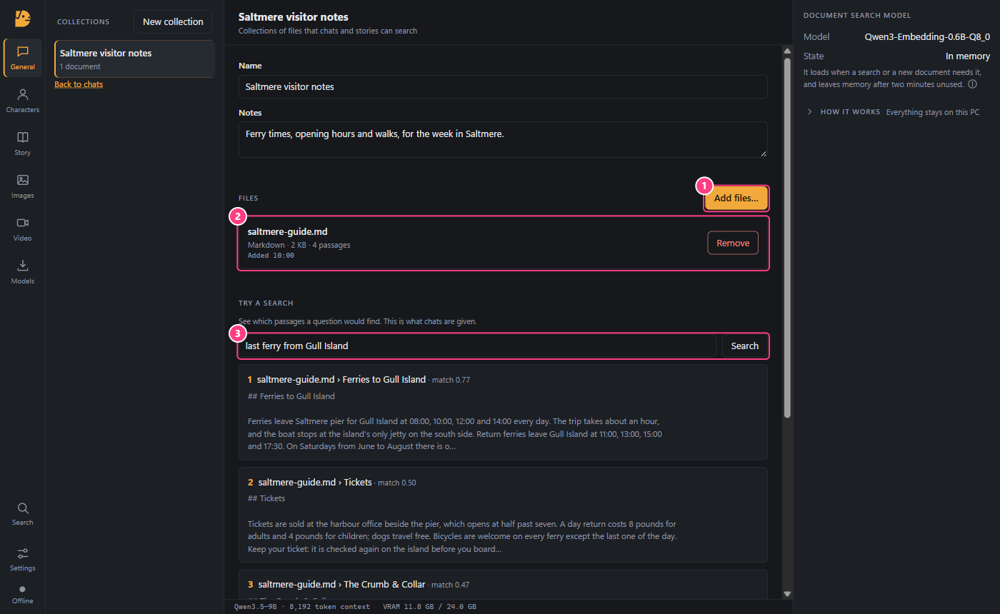
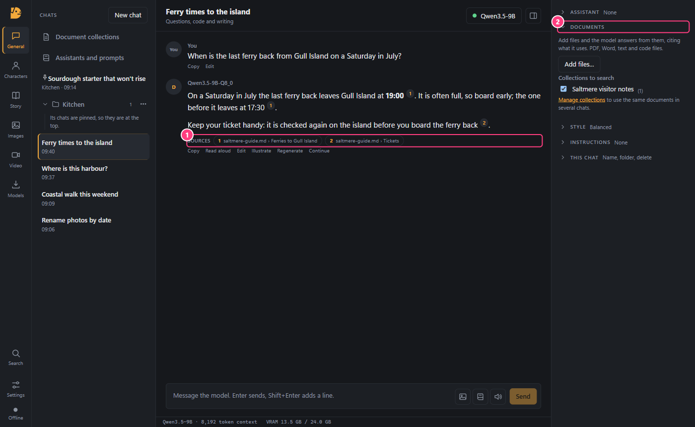
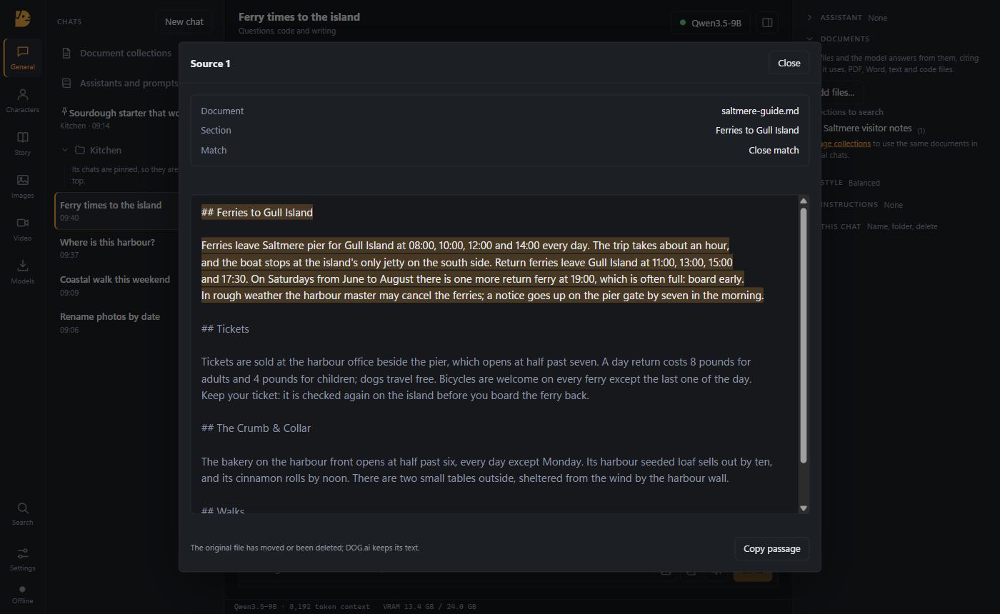

<!-- covers: general/documents -->
<!-- sources: src/DogAI.UI/Pages/Documents.razor, src/DogAI.UI/Components/Documents/**, src/DogAI.Core/Documents/** -->
# Documents

A chat can answer from your own files: manuals, notes, a story's world. DOG.ai cuts each file into passages of a few
hundred words; when you send a message, the passages closest to it are sent to the model with it. A General chat says
which passages it used, as [1], [2]. Character chats and stories use them as background. Nothing leaves this PC.

It needs a **document search model**, a small model that turns every passage into numbers that capture its meaning,
once. Get one in **Models** › **Get models** › **Recommended** (see [Models](models.md)); until there is one, the
**Documents** panel says so.

## Files for one chat

Open **Documents** in a chat's side panel and press **Add files…**. PDF, Word (`.docx`), markdown, text and code files
can be added. Their text is copied into DOG.ai, so the files can be moved or deleted afterwards. These files belong to
that chat alone and go when it is deleted.

## Collections

A **collection** is a set of files that any chat or story can search. **Document collections** at the top of
General's chat list opens them; **New collection** makes one.

1. **Add files…** adds files to the collection. Each is indexed in the background; its line says when it is ready and
   how many passages it has. **Remove** takes it out.
2. The files in the collection.
3. **Try a search** shows which passages a question would find, closest first: what a chat would be given.

The side panel says whether the document search model is in memory. It loads when a search or a new file needs it,
and leaves memory after two minutes unused. **Delete collection** deletes the collection and its passages; the
original files on your PC are not touched.

## Ask with a collection

In a chat's side panel, open **Documents** (2) and tick the collections the chat should search under **Collections to
search**. Stories and character chats have the same panel, named **Reference documents**.

The reply marks what it took from the files with numbers, and lists them under **Sources** (1). Click a number or a
source to see the passage in its file:

**Copy passage** copies it. If the original file has moved or been deleted, DOG.ai still has its text, and says so.

[Back to the contents](README.md)
