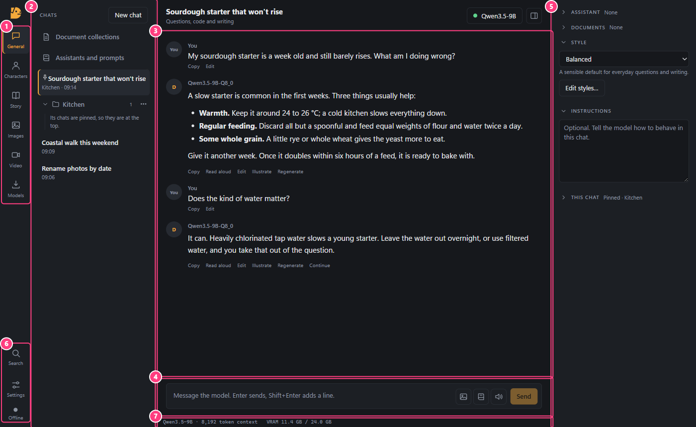
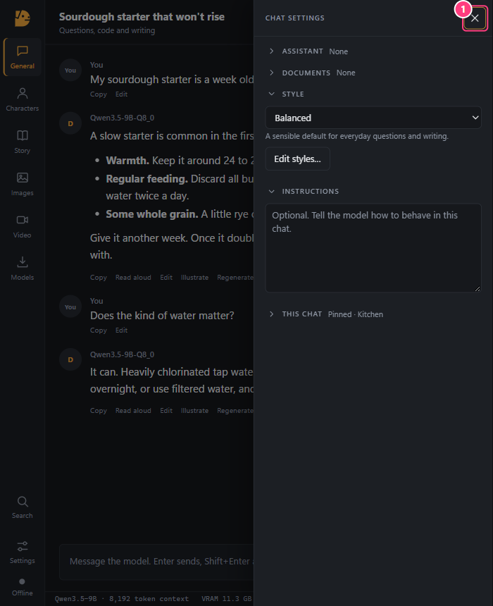
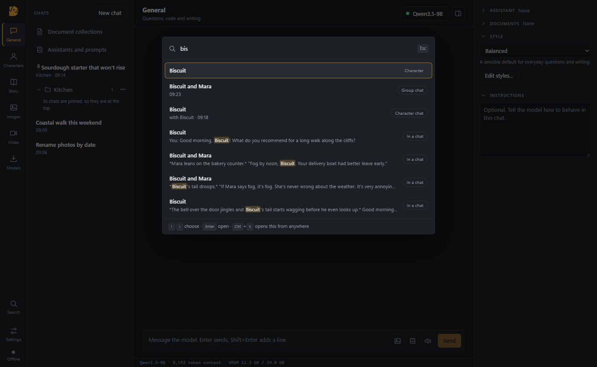
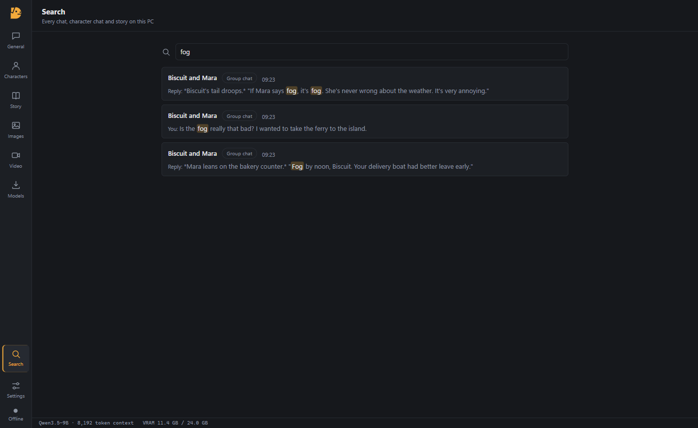
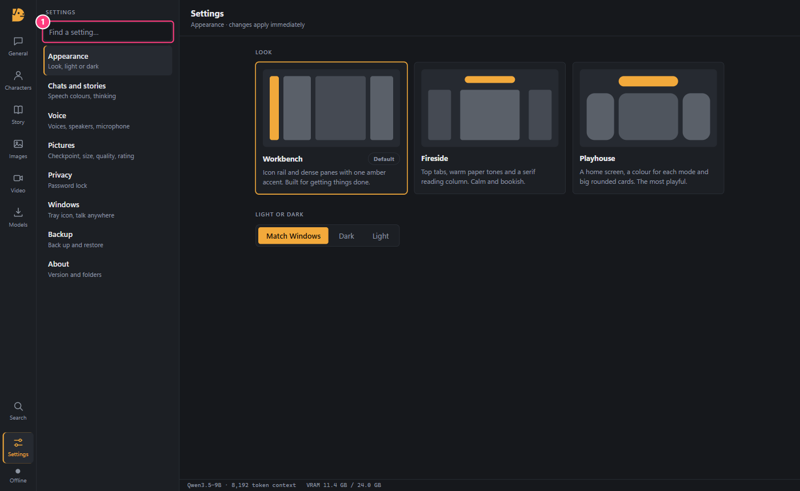
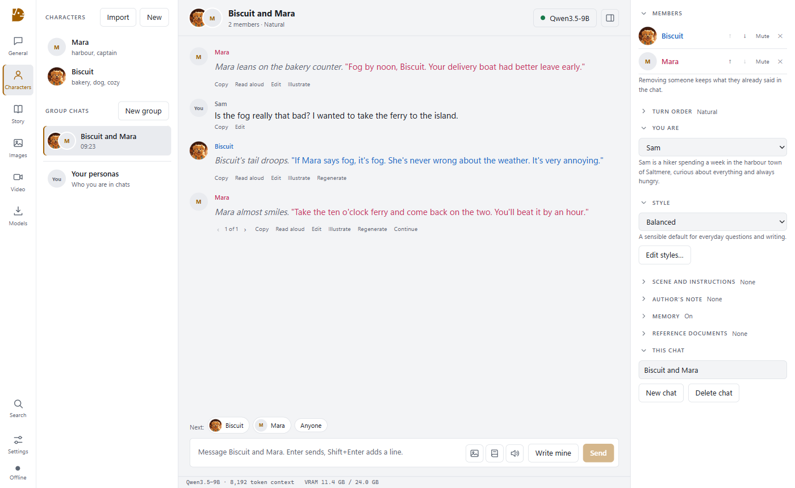
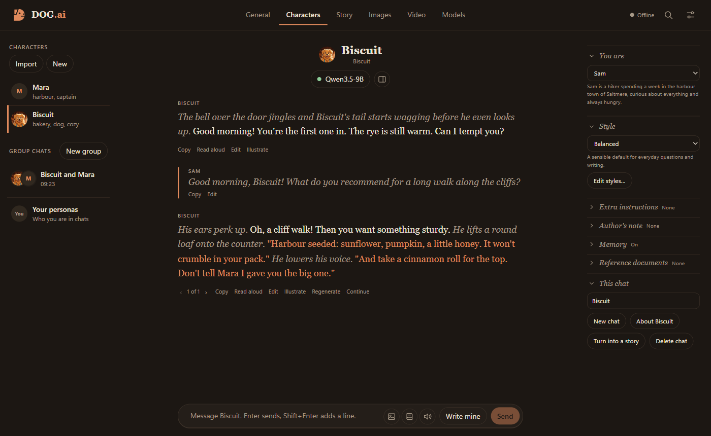
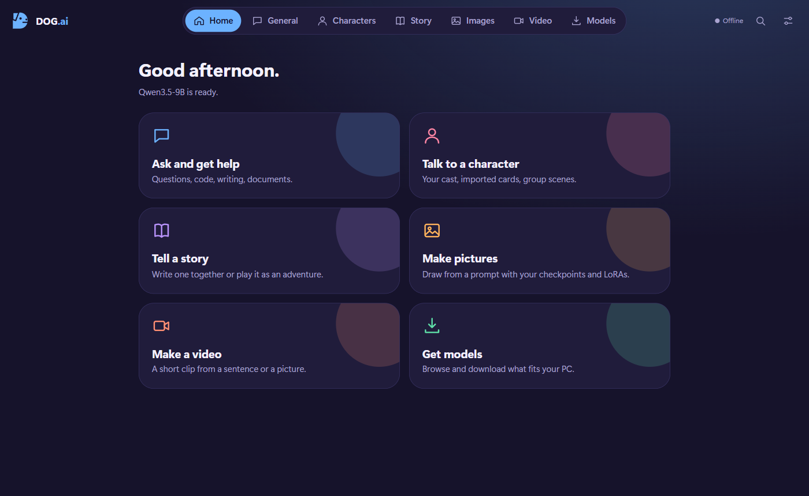

<!-- covers: search, settings/appearance -->
<!-- sources: src/DogAI.UI/Layout/**, src/DogAI.UI/Components/{AsideDrawer,EmptyState,EngineStatus,Fold,Icon,InfoButton,JumpBox,LinkGuard,Logo,Modal,MoreMenu,NavButtons,OfflineBadge,PageTabs}.razor, src/DogAI.UI/Components/Modes.cs, src/DogAI.UI/Components/Chat/{AsideRegion,AsideToggle,SidePanel}.razor, src/DogAI.UI/Pages/{Home,Search}.razor, src/DogAI.Core/Search/**, src/DogAI.Core/Appearance/AppearanceState.cs, src/DogAI.Core/Settings/SettingsCatalog.cs -->
# Finding your way

## The parts of the window

Every screen has the same parts. Here is General with a chat open:

1. **The places.** General (questions, code and writing), Characters (character chats and group chats), Story,
   Images, Video, and Models (getting and managing models).
2. **The list** of the place you are in: chats, characters, stories. **New chat** and similar buttons are at its top.
3. **The main area:** the chat, the story, the picture.
4. **The box you type in.** Enter sends; Shift+Enter starts a new line.
5. **The side panel:** what can be changed for this chat or screen. Each part folds up when you click its heading, and
   DOG.ai remembers which parts you keep open.
6. **Search, Settings, and Offline.** Offline turns green and says Online while the Models section is downloading or
   looking something up; every other part of DOG.ai stays offline always.
7. **The status bar:** the model in memory, how much of a conversation it sees at once (its context), its speed, and
   how much of the graphics card is in use.

The button at the top right of a chat (beside the model's name) hides the side panel and shows it again.

## On a small window

Below a certain width the list and the side panel make room for the chat. The side panel then opens from the right,
over the page, with the button at the top right, and closes with its × (1), Escape, or a click beside it:

## Jump anywhere: Ctrl+K

Press **Ctrl+K** anywhere and type a few letters. DOG.ai lists the screens, characters, chats, stories, document
collections and settings that match; after three letters it also finds words inside your chats. Use the arrow keys and
Enter, or click. Escape closes it. With nothing typed it lists the five chats you used last.

## Search

**Search** (bottom left) finds words inside every chat and story. Click a result to open the chat at that message.

## Settings

**Settings** (bottom left) lists its parts on the left; the box at the top (1) finds a setting by name. Search and
Settings each have a way back to where you were.

Every setting is described on the [Settings page](settings-and-help.md).

## The three looks

**Settings** › **Appearance** changes how DOG.ai looks. Each look comes dark and light, and **Match Windows** follows
your Windows setting. Nothing else changes between them: the same places, buttons and settings.

| Workbench (light) | Fireside (dark) | Playhouse (dark) |
|---|---|---|
|  |  |  |

- **Workbench** (the one DOG.ai starts with): compact, with everything in view.
- **Fireside:** warmer colours and a book-like typeface for reading chats and stories.
- **Playhouse:** a home screen with a big button for each place, and a colour for each.

[Back to the contents](README.md)
