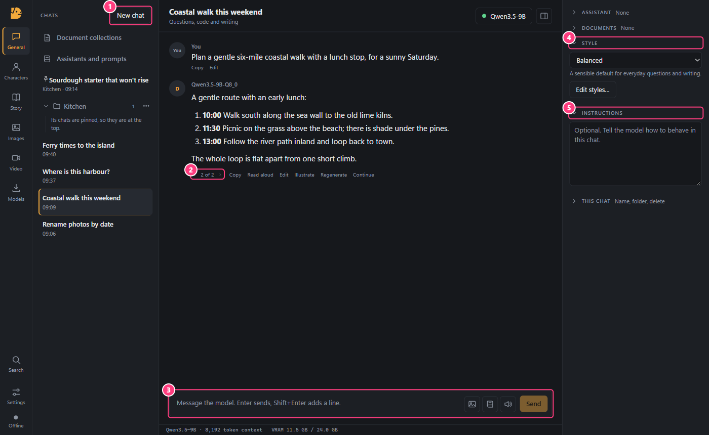
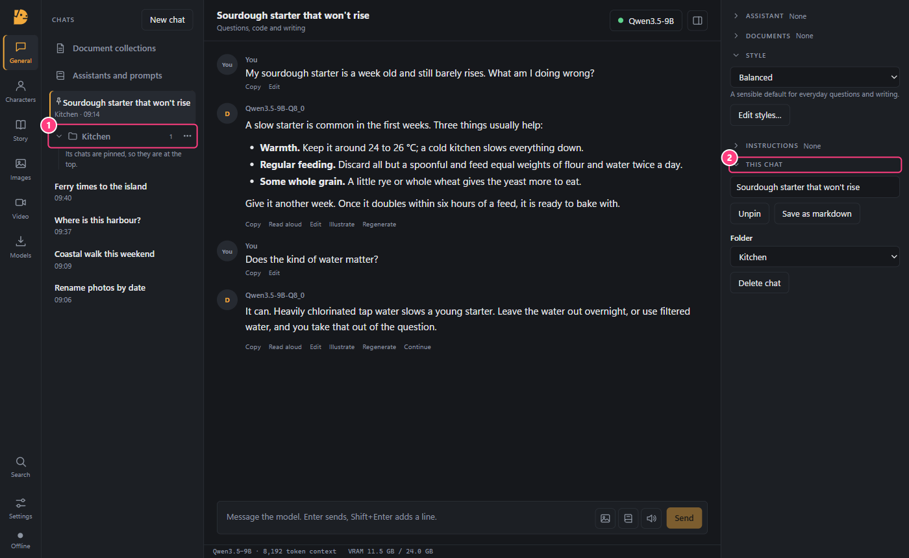
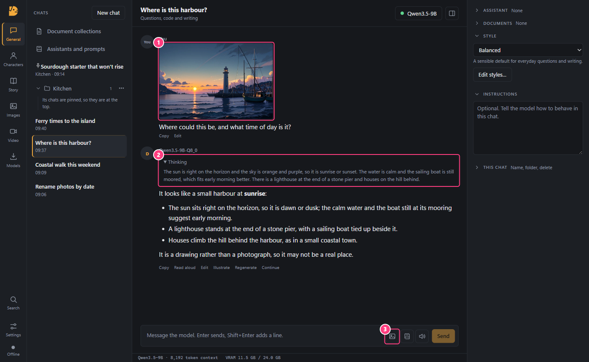
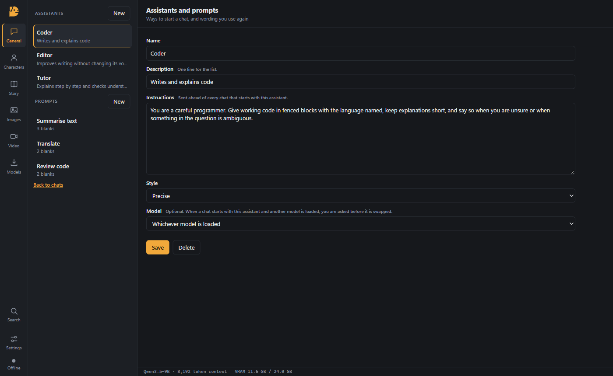
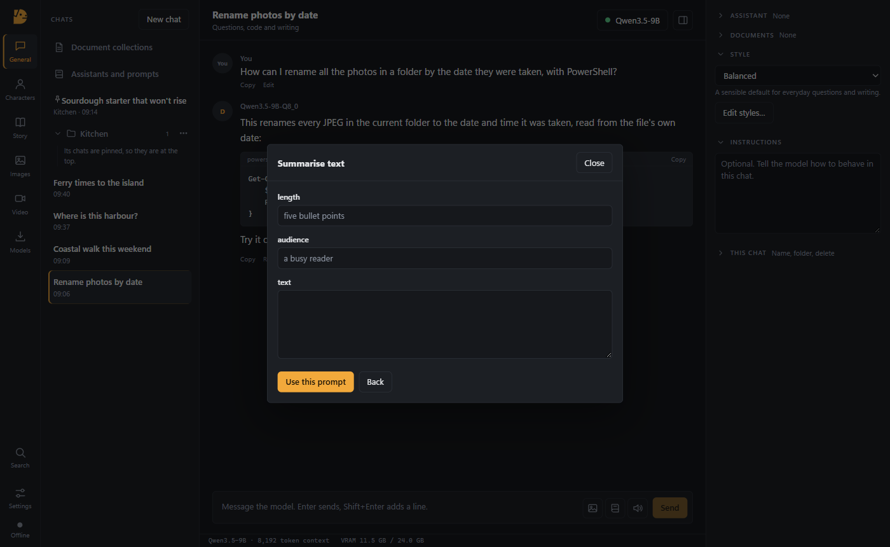

<!-- covers: general, general/library -->
<!-- sources: src/DogAI.UI/Pages/{General,Library}.razor, src/DogAI.UI/Components/Chat/**, src/DogAI.UI/Components/{MarkdownView,MessageView,ModelPicker}.razor, src/DogAI.UI/Components/Library/{AssistantPanel,PromptPicker}.razor, src/DogAI.Core/Chat/**, src/DogAI.Core/Library/** -->
# General chat

**General** is the place for questions, code and writing. It answers with the model in memory, and everything you type
and everything it writes stays on this PC.

## Ask a question

Type in the box at the bottom and press Enter. Shift+Enter starts a new line. Each conversation is kept in the list on
the left, newest first; **New chat** (1) starts another.

Under each message are its actions:

- **Copy** puts the text on the clipboard. **Read aloud** speaks it (see [Voice](voice.md)).
- **Edit** changes a message. Edit your question and press **Save and ask again**, and the model answers the new
  wording; edit a reply to correct it.
- **Regenerate** writes the reply again. Nothing is overwritten, here or by Edit: the arrows under a message (2) say
  which version you are reading ("2 of 2") and switch between them.
- **Continue** carries on a reply that stopped short.
- **Illustrate** draws a picture of a moment in the reply (see [Images](images.md)).
- **Prompt** shows exactly what the model was sent for that reply, on replies written on this PC.

The box at the bottom (3) has buttons for a picture, a saved prompt, and reading replies aloud as they are written.
While a reply is being written the box shows **Stop**. Code in a reply comes in a coloured block with its own **Copy**
button; formulas are drawn as formulas.

The side panel on the right is for this chat only:

- **Style** (4) is how freely the model writes: **Precise** for code and facts, **Balanced** (the default),
  **Creative** for brainstorming and prose, **Wild** for surprises. **Edit styles…** changes them or makes your own.
- **Instructions** (5) are standing orders for this chat, such as "answer in French" or "keep it short".
- **Assistant** and **Documents** are below.

The model button at the top right shows which model is in memory and loads another. The model General starts with is
set in **Models** › **On this PC** › **Chat models** (see [Models](models.md)).

## Folders, pins and names

Open **This chat** at the bottom of the side panel (2) to rename the chat, **Pin to top**, save it with **Save as
markdown**, put it in a **Folder**, or **Delete chat**. Choose **New folder…** in the list of folders to make one.

Pinned chats sit at the top of the list. A folder (1) folds open and shut with a click; its **⋯** button renames or
deletes it. Deleting a folder keeps its chats: they move back to the main list.

## Ask about a picture

When the model in memory can see pictures, the box has a picture button (3). Press it to choose up to four pictures,
or paste one, or drag files onto the box. They wait above the box until you send, and you can take any of them out.
The picture is sent with your question (1).

DOG.ai makes each picture into a plain JPEG of at most 1,024 pixels before it is kept, with nothing else from the file.
A model that cannot see shows no picture button. Whether a model can see is shown in **Models** as "Sees pictures"
(see [Models](models.md)).

Some models think before they answer. Their thinking is folded away under **Thinking** (2); click it to read it.
While a model is still thinking, **Answer now** beside **Stop** ends the thinking and has it answer. How long a model
may think is set in **Settings** › **Chats and stories** (see [Settings](settings-and-help.md)).

## Assistants

An **assistant** is a way to start a chat: standing instructions, a style, and a model if you want one. Choose one
under **Assistant** in a chat's side panel; its instructions and style are copied into that chat. DOG.ai comes with
three (Coder, Editor, Tutor). Make your own, or change these, in **Assistants and prompts** at the top of the chat list:

**Model** is optional. When a chat starts with an assistant that prefers another model, the side panel offers to swap
to it; nothing is swapped without asking.

## Saved prompts

A **prompt** is wording you use again, with blanks you fill in each time. Write a blank as `[[name]]`, or
`[[name|a default]]` to start it with a suggestion. Make them under **Prompts** in **Assistants and prompts**.

In any chat, press the book button beside the message box (**Use a saved prompt**) and pick one. Fill in its blanks and
press **Use this prompt**: the finished text goes into the message box for you to read before sending.

## Ask about your own files

**Documents** in the side panel lets a chat answer from files you give it, and cite them. That is on its own page:
[Documents](documents.md).

[Back to the contents](README.md)
