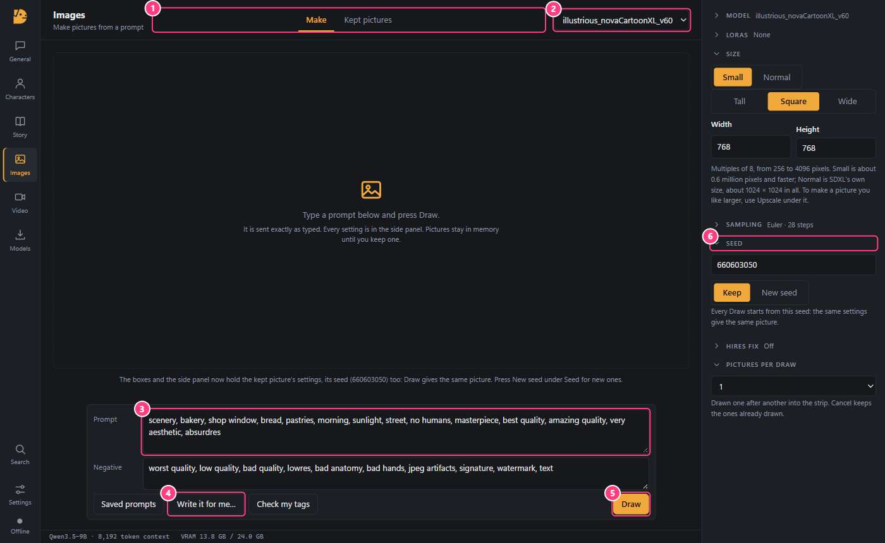
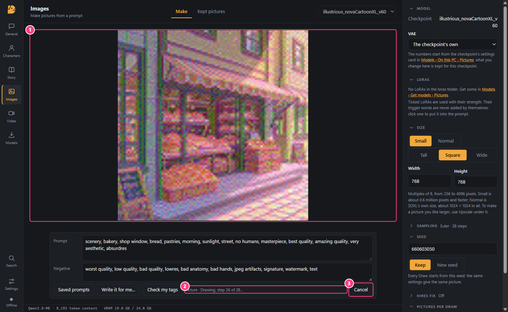
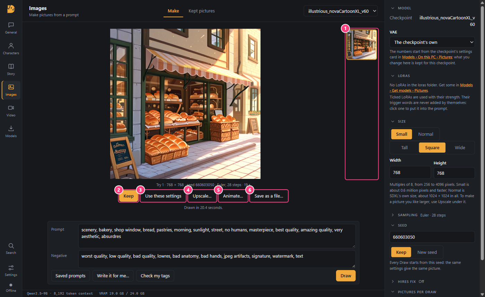
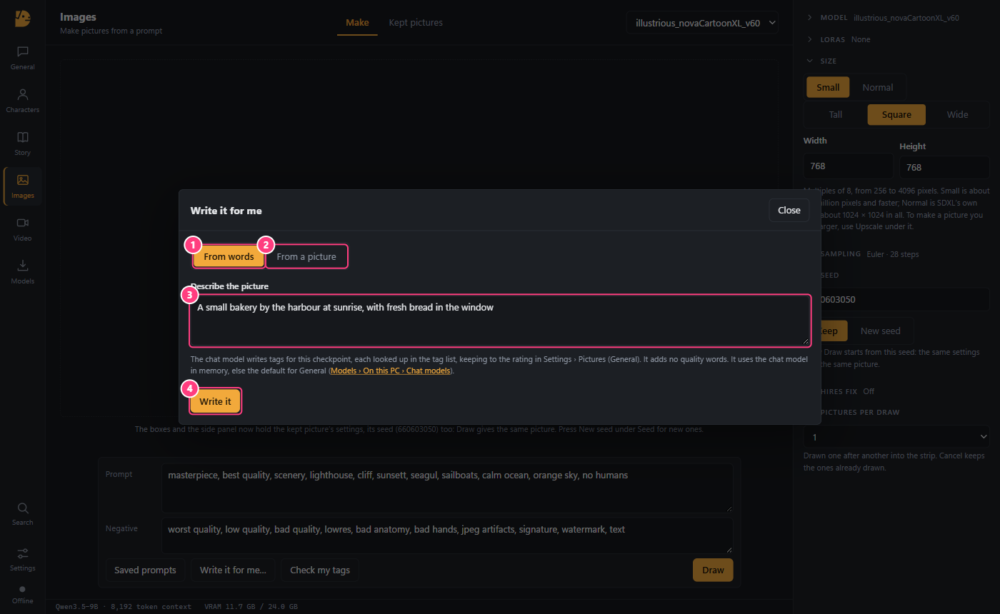
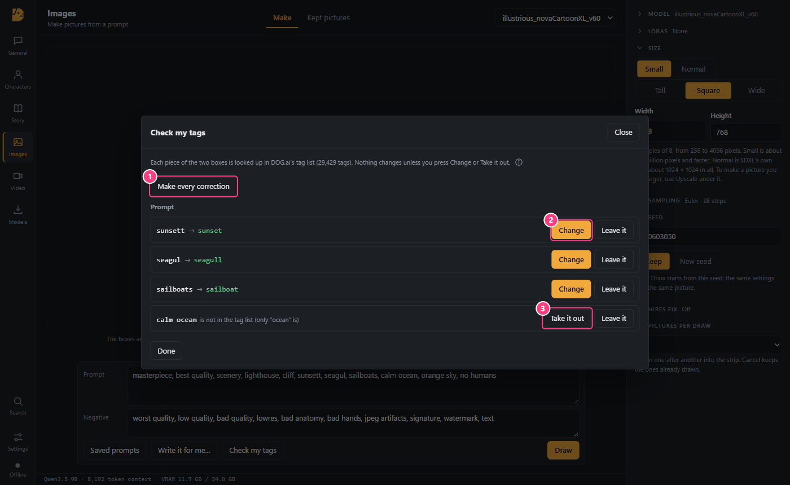
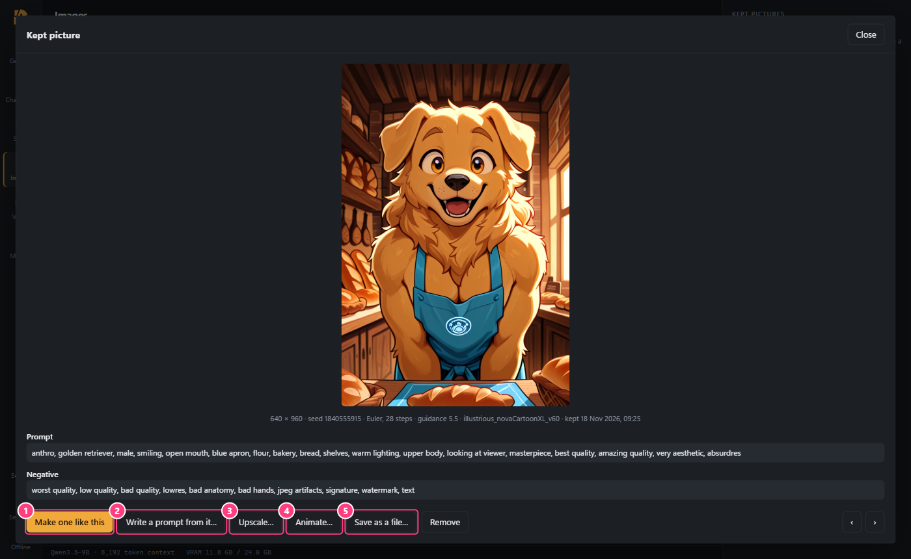
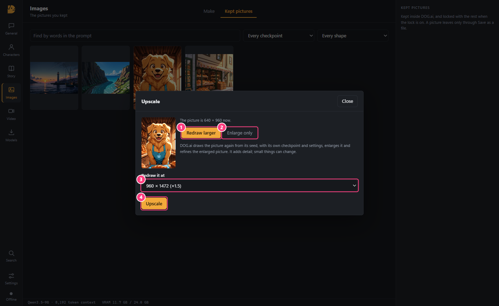
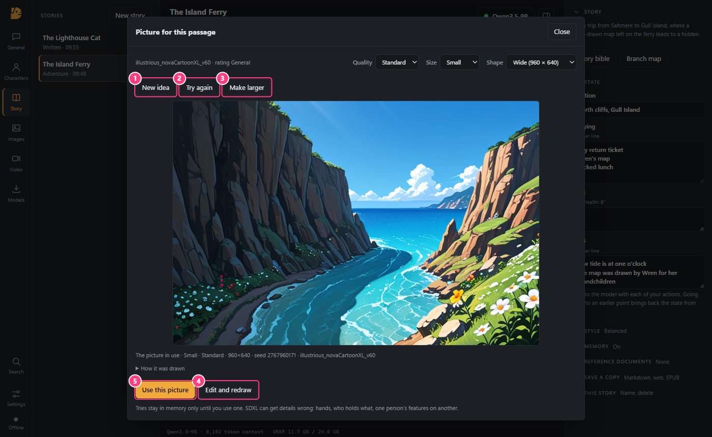
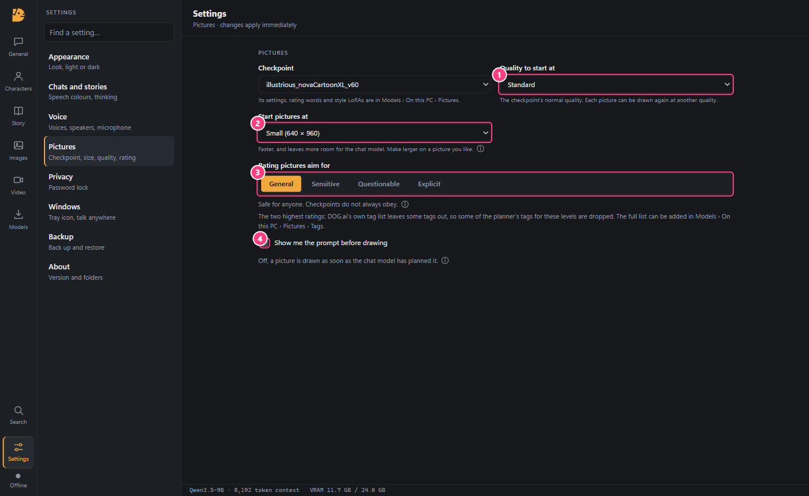

<!-- covers: images, images/kept, settings/pictures -->
<!-- sources: src/DogAI.UI/Pages/ImagesMake.razor, src/DogAI.UI/Components/Images/{KeptPictures,PictureSettings,PromptHelperBox,SavedPromptsBox,SeedRow,TagCheckBox,UpscaleBox}.razor, src/DogAI.Core/Images/Images*.cs, src/DogAI.Core/Images/{PictureUpscale,SavedPicturePrompts}.cs -->
# Images

**Images** draws pictures from a prompt you write, with the picture model on your own graphics card. What you type is
sent exactly as typed, and a picture stays in memory until you keep it.

Drawing needs the picture engine and a checkpoint (the model that draws). When one is missing, the page says so and
**Open Models** takes you to the place to get it (see [Models](models.md)).

## Make a picture

1. **Make** draws; **Kept pictures** holds the pictures you kept.
2. The checkpoint pictures are drawn with here. Choosing another one here changes nothing elsewhere in DOG.ai.
3. **Prompt** is what to draw, **Negative** what to keep out. Most checkpoints of the kind DOG.ai recommends read tags
   separated by commas ("scenery, harbor, sunrise"); the checkpoint's own quality words go at the start or the end.
4. **Write it for me…** and the two helpers beside it, **Saved prompts** and **Check my tags** (see below).
5. **Draw** draws what is typed. With more than one picture per Draw it says how many ("Draw 3").
6. **Seed**, in the side panel.

Every setting is in the side panel, each part folding open and shut:

- **Model:** the checkpoint and its **VAE** ("The checkpoint's own" unless pictures come out black or washed out). The
  numbers start from the checkpoint's settings card in **Models › On this PC › Pictures**; what you change here is
  kept for this checkpoint, and **Back to the card's numbers** undoes it.
- **LoRAs:** tick one to use it, at the strength beside it. Its trigger words show as buttons under it; click one to
  put it into the prompt. They are never added by themselves.
- **Size:** **Small** (faster) or **Normal**, then **Tall**, **Square** or **Wide**; or type a width and height
  (multiples of 8).
- **Sampling:** sampler, scheduler, steps, guidance and clip skip.
- **Seed** (6): empty, every picture gets a new seed. With a number, the same seed and settings draw the same picture
  again. **Keep** takes the seed of the picture shown; **New seed** goes back to a new one each time.
- **Hires fix:** "Draw it larger, then refine it".
- **Pictures per Draw:** up to 8, drawn one after another.

The picture above shows the Make tab after **Make one like this** on a kept picture: the boxes and the side panel hold
that picture's prompt and settings, its seed too, so **Draw** gives the same picture.

### While it draws

The picture shows as it forms (1), the line beside the buttons says how far it has come (2), and **Cancel** (3) stops
it; pictures already finished in the same Draw stay. When a chat model is in memory and the graphics card has no room
for both, DOG.ai sets the chat model aside while it draws, and it comes back with your next message.

### A finished picture

Each picture goes into the strip (1); click one to see it again. Under the picture are its facts (its try number, size,
seed, sampler and how long it took), and:

2. **Keep** keeps it inside DOG.ai, under **Kept pictures**. Pictures you do not keep are gone when DOG.ai closes.
3. **Use these settings** puts that picture's prompt, checkpoint and settings back, seed included.
4. **Upscale…** makes a larger picture from it (see below).
5. **Animate…** starts a short video clip from it (see [Video](video.md)). It shows only when the video model is
   installed.
6. **Save as a file…** saves it as a WebP picture.

## The helpers

### Write it for me

**From words** (1): describe the picture in a sentence (3) and press **Write it** (4). The chat model writes tags for
this checkpoint, each looked up in DOG.ai's tag list and kept to the rating in **Settings** › **Pictures**. It adds no
quality words. Read what it wrote, then press **Add after the prompt** or **Replace the prompt**; nothing reaches the
boxes until you do.

**From a picture** (2): the chat model looks at a picture and writes a prompt for one like it. Press **Use the picture
shown** for the picture on the Make tab, or **Choose a file…**; a kept picture has **Write a prompt from it…** in its
large view. This needs a chat model that can see pictures ("Sees pictures" in [Models](models.md)).

Both use the chat model in memory, else the default for General.

### Check my tags

Each piece of the two boxes is looked up in DOG.ai's tag list, which a checkpoint of this kind was trained on. A piece
that looks like a slip gets **Change** (2), with the tag it probably meant ("sunsett → sunset"); a piece that is no tag
gets **Take it out** (3), and says when only part of it is ("only "ocean" is"). **Leave it** keeps a piece as it is,
and **Make every correction** (1) presses every Change at once. Nothing changes unless you press.

### Saved prompts

**Saved prompts** keeps prompts you use again. **Save these as…** stores what is in the two boxes under a name.
Each saved prompt has **Replace** (put it in the boxes in place of what is typed) and **Add** (after what is typed),
and in its **⋯** menu **Edit…**, **Delete…** and **Start with this**: a prompt marked so fills the boxes whenever
DOG.ai starts. With none marked they start with the checkpoint's own quality words and negative prompt.

## Kept pictures

**Kept pictures** shows every picture you kept, newest first. **Find by words in the prompt** and the two lists beside
it (**Every checkpoint**, **Every shape**) narrow it down. Click a picture to see it large, with its facts, its prompt
and its negative prompt:

1. **Make one like this** puts its prompt, checkpoint and settings back on the Make tab, seed included.
2. **Write a prompt from it…** opens Write it for me with this picture.
3. **Upscale…** makes a larger copy (see below).
4. **Animate…** starts a video clip from it.
5. **Save as a file…** saves it as a WebP picture.

**Remove** deletes it from DOG.ai; it cannot be brought back. The arrows at the bottom right go to the next and the
previous picture. Kept pictures are inside DOG.ai and are locked with the rest when the lock is on (see
[Privacy and backups](privacy-and-backups.md)); a picture leaves only through **Save as a file…**.

## Upscale

**Upscale…** makes a larger picture beside the original, which stays as it is. There are two ways:

1. **Redraw larger:** DOG.ai draws the picture again from its seed, with its own checkpoint and settings, enlarges it
   and refines the enlarged picture. It adds detail; small things can change. Choose the size under **Redraw it at**
   (3).
2. **Enlarge only:** an upscaler file makes the picture larger as it is. Nothing is drawn again, so nothing in it
   changes. It needs an upscaler (an ESRGAN `.safetensors` file) at the top of the upscalers folder;
   **Models › Get models › Pictures** has one to download (Real-ESRGAN x4plus).

**Upscale** (4) starts it. On the Make tab the larger picture goes into the strip; from Kept pictures it is shown in
the dialog, with **Keep it** and **Discard**.

## Pictures in chats and stories

**Illustrate** under a reply or a story passage, and **Generate picture** in a character's editor, draw with the
picture maker. There the chat model plans the picture from what is written and from the people's **Looks** (see
[Characters](characters.md)), DOG.ai builds the prompt from that plan, and the picture model draws it. Here it is
opened with **Redraw picture** on a story's picture:

1. **Draw** plans and draws; once there is a picture it says **New idea**: a new plan.
2. **Try again** draws the same plan with a new seed, without asking the chat model again.
3. **Make larger** draws the picture shown at a larger size.
4. **Edit and redraw** lets you change the prompt, the quality, the shape and the LoRAs, and draws with the same
   seed.
5. **Use this picture** puts the picture where it belongs.

**Quality**, **Size** and **Shape** at the top apply to the next picture; **How it was drawn** shows the prompt. Tries
stay in memory only until you use one.

## Settings › Pictures

**Checkpoint** is the one the picture maker draws with (it is also the Pictures default in [Models](models.md)).

1. **Quality to start at:** Draft, Standard or Fine. Each picture can be drawn again at another quality.
2. **Start pictures at:** Small (faster, and leaves more room for the chat model) or Normal. It is also where the
   Images section's size starts.
3. **Rating pictures aim for:** General, Sensitive, Questionable or Explicit. The chat model plans to it and DOG.ai
   adds the checkpoint's word for it; the words for the ratings above it go into the negative prompt. Checkpoints do
   not always obey. The Images section sends your prompt as you typed it, without rating words.
4. **Show me the prompt before drawing:** the picture maker shows the planned prompt, and the place and light it
   chose, before it draws, so you can change them.

[Back to the contents](README.md)
