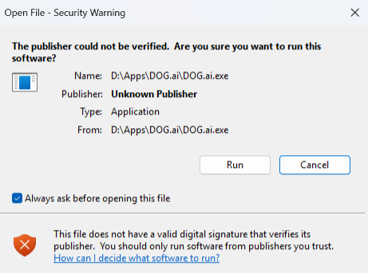
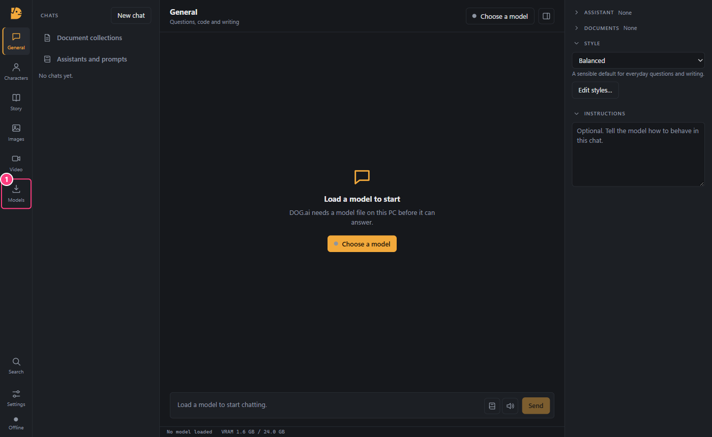
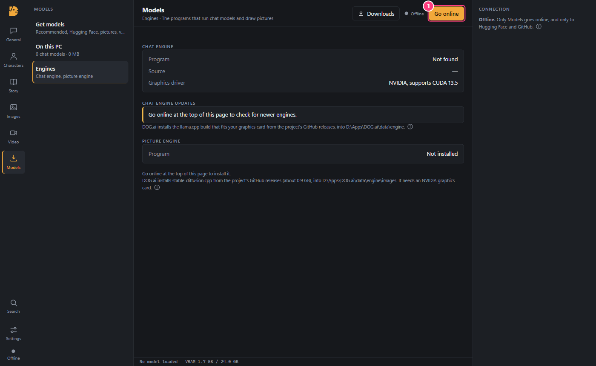
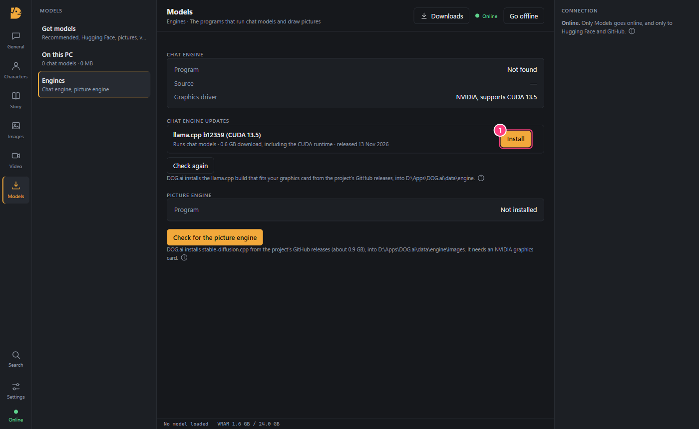
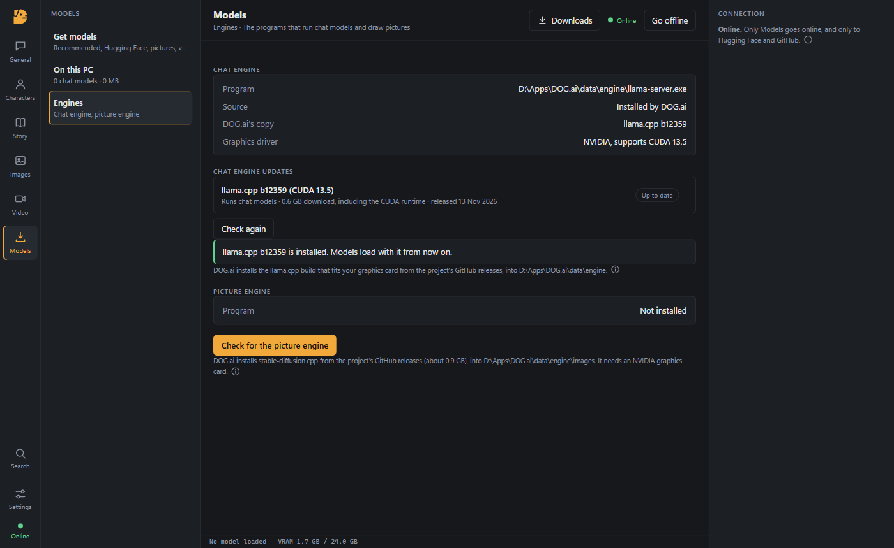
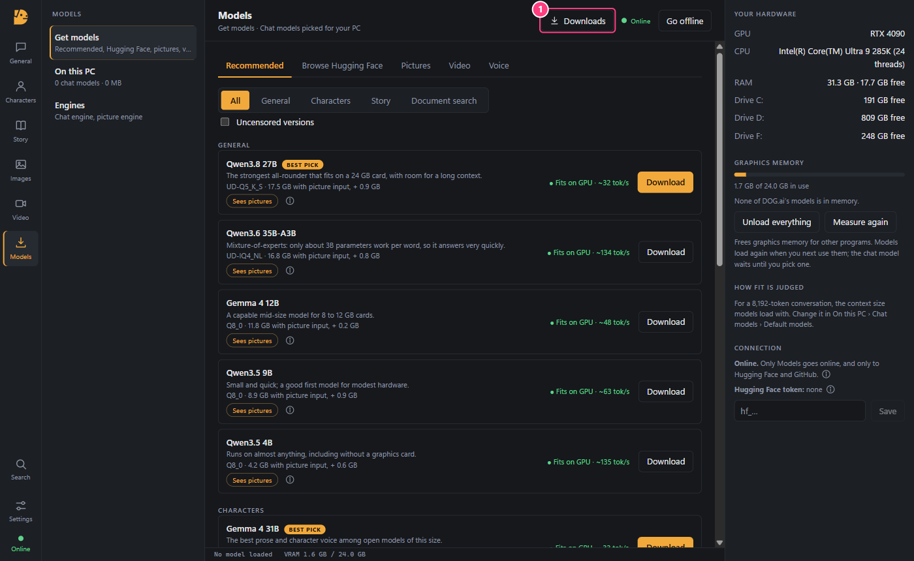
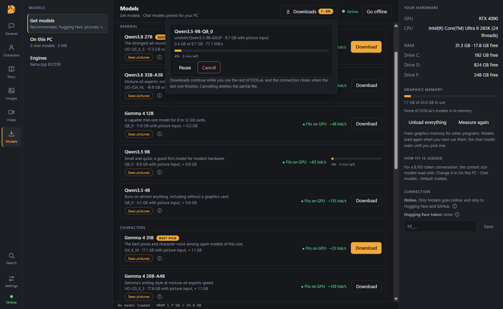
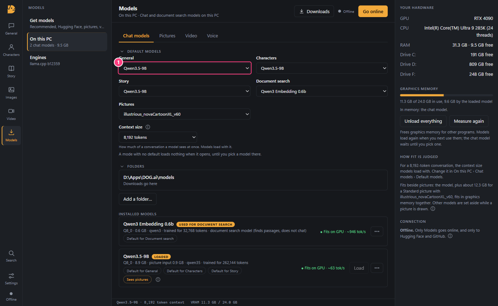
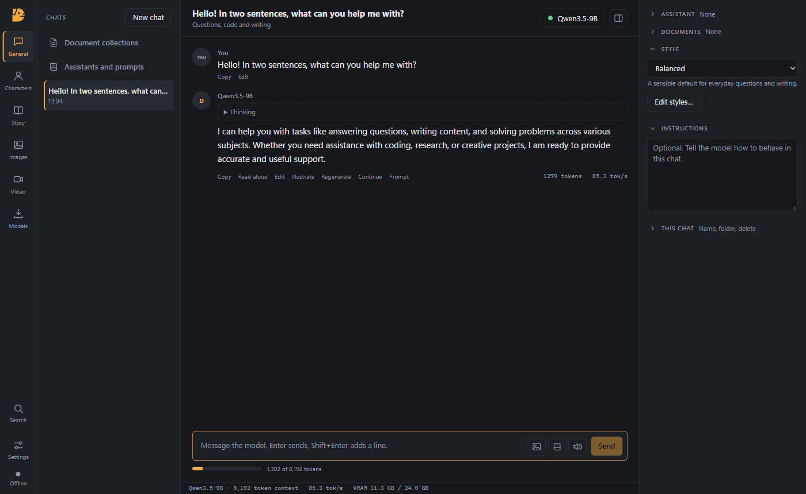

<!-- covers: -->
<!-- sources: src/DogAI.Launcher/**, src/DogAI.App/DogAI.App.csproj, src/DogAI.App/Properties/PublishProfiles/**, src/DogAI.Core/AppPaths.cs, src/DogAI.Hub/EngineUpdater.cs, src/DogAI.Core/Models/curated-models.json, src/DogAI.UI/Pages/General.razor, src/DogAI.UI/Components/Models/{EngineTab,RecommendedTab,DownloadButton,DownloadsTray,DownloadsList,DefaultsBlock}.razor -->
# Install and set up

This page takes you from the download to your first reply. It takes about ten minutes, most of it spent downloading.

## What you need

- **Windows 10 or 11, 64-bit.** DOG.ai uses the WebView2 runtime, which Windows 11 and an up-to-date Windows 10 already
  have.
- **An NVIDIA graphics card** for fast replies, and for pictures and video at all. Chat also works on other cards and
  without one, more slowly.
- **Disk space:** about 0.4 GB for DOG.ai, 0.6 GB for its chat engine, and 4 to 20 GB for each model.

## 1. Download and unzip

1. Download `DOG.ai-win-x64.zip` from the project's [Releases page](https://github.com/Carpe-Canem/DOG.ai/releases).
2. **Before you unzip it**, right-click the zip, choose **Properties**, tick **Unblock** at the bottom of the General
   tab, and press **OK**. Windows marks every file that comes from the internet; unblocking the zip first means it does
   not ask about each program inside.
3. Unzip it wherever you like: a folder in your documents, another drive, a USB stick. DOG.ai is portable. Everything
   it keeps (your chats, settings, engines and models) goes into two folders that appear beside it, `data` and
   `models`. Nothing is written anywhere else, and nothing is installed into Windows.

The folder then holds `DOG.ai.exe`, `portable.txt` and a folder named `app`. Leave them together.

If you skipped step 2, Windows asks once whether to run a program from an unknown publisher. DOG.ai is not signed with
a certificate, so it says "Unknown Publisher". Press **Run** if the folder is the one you unzipped:



Depending on your Windows settings it may instead show a blue box, "Windows protected your PC". Then press **More
info**, check that the program is `DOG.ai.exe`, and press **Run anyway**.

## 2. Start DOG.ai

Double-click `DOG.ai.exe`. The window opens on **General**, the place for questions, code and writing. It cannot
answer yet: it needs an engine to run models, and a model.



Open **Models** in the bar on the left (1).

## 3. Get the chat engine

The chat engine is the program that runs language models: [llama.cpp](https://github.com/ggml-org/llama.cpp)'s
`llama-server`. DOG.ai downloads the build that fits your graphics card into its own `data\engine` folder.

1. Choose **Engines** in the Models list. **Chat engine** says **Not found**.
2. Press **Go online** at the top right (1). DOG.ai is offline until you do this, and only the Models section can go
   online.

   

3. Press **Check for updates**. DOG.ai asks GitHub for the newest build and offers it, with its size (about 0.6 GB with
   the CUDA runtime for NVIDIA cards). Press **Install** (1).

   

When it is done, **Chat engine** shows where the program is and which build it is:



## 4. Download a model

1. Choose **Get models** in the Models list. **Recommended** lists models picked for this kind of use, each judged
   against your PC: **Fits on GPU** means it runs entirely on your graphics card, with a rough speed.
2. Press **Download** beside one. **Qwen3.5 9B** is a good first model: quick, and able to look at pictures you give
   it. The row says which version DOG.ai picked for your card, how large it is with its picture input, and whether it
   fits. If it says it does not, take **Qwen3.5 4B**.

   

3. **Downloads** at the top (1) shows how far it has got. You can use the rest of DOG.ai meanwhile. When the last
   download finishes, DOG.ai goes offline again by itself.

   

## 5. Make it the default

Choose **On this PC** in the Models list. Under **Default models**, set **General** to the model you downloaded (1).
From now on DOG.ai loads it by itself when you open General. Do the same for **Characters** and **Story** if you like;
one model can do all three.



## 6. Your first reply

Open **General** in the bar on the left. The model loads (the button at the top right shows its name when it is in), then type
a question in the box at the bottom and press **Enter**.



Models like Qwen3.5 think before they answer. **Thinking** above the reply opens what it thought; how long a model may
think is in **Settings** › **Chats and stories**.

That is all DOG.ai needs. The [next page](finding-your-way.md) shows your way around.

## Moving, updating and removing DOG.ai

- **Moving:** close DOG.ai and move the whole folder. It notices the move at its next start.
- **Updating:** close DOG.ai, download the new zip, delete the old `app` folder, and unzip the new `DOG.ai.exe`,
  `portable.txt` and `app` folder in its place. Your `data` and `models` folders are left as they are.
- **Removing:** delete the folder. DOG.ai leaves nothing behind elsewhere on your PC.

## Building it yourself

DOG.ai is a .NET 9 program. With the [.NET 9 SDK](https://dotnet.microsoft.com/download/dotnet/9.0) installed:

```
git clone https://github.com/Carpe-Canem/DOG.ai.git
cd DOG.ai
dotnet publish src/DogAI.App -p:PublishProfile=win-x64
```

The portable folder is then `publish\win-x64`. Copy its `DOG.ai.exe`, `portable.txt` and `app` folder wherever you
like and go on from step 2.

[Back to the contents](README.md)
