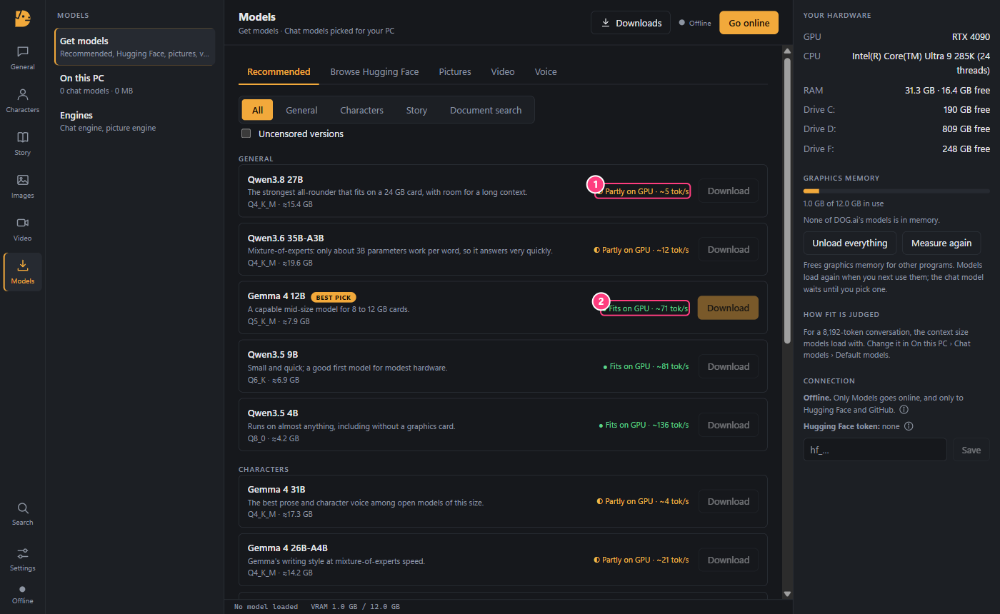
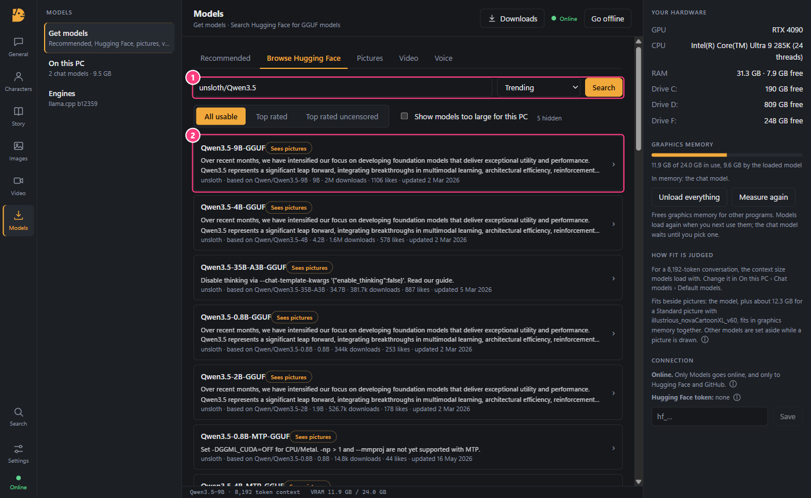
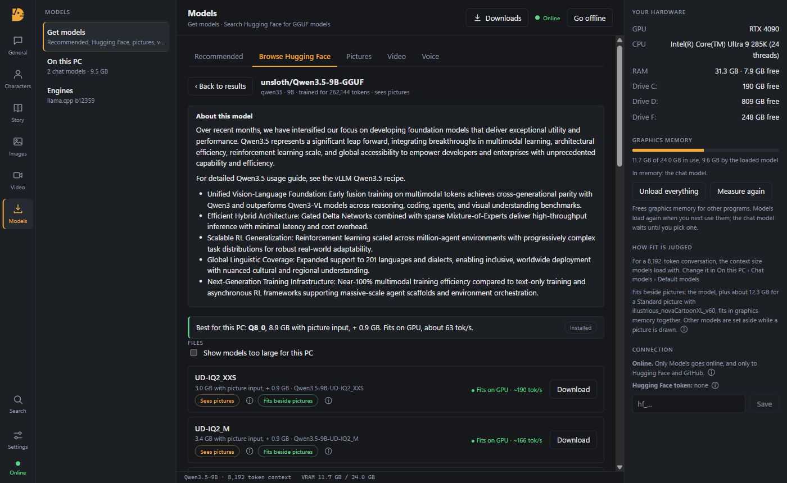
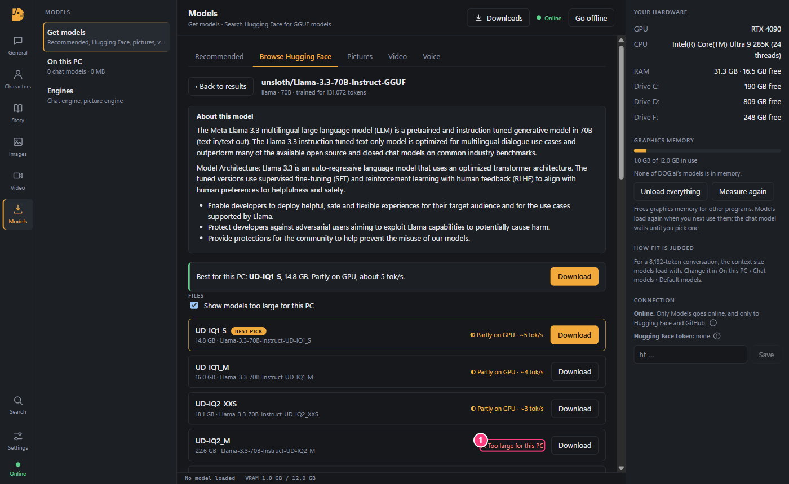
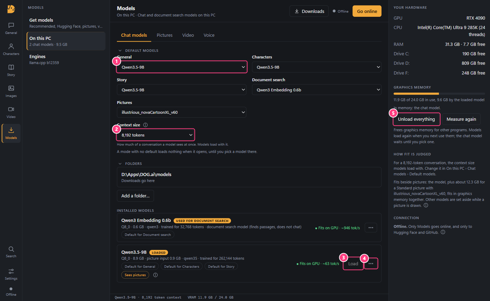
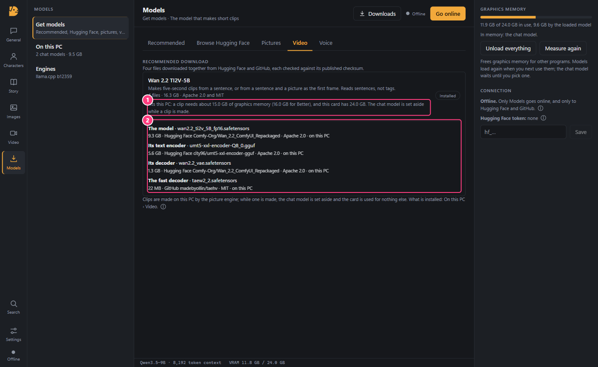

<!-- covers: models, models/downloads, models/browse, models/get-pictures, models/get-video, models/get-voice, models/library, models/pictures, models/pictures/loras, models/pictures/tags, models/video, models/voice, models/engines -->
<!-- sources: src/DogAI.UI/Pages/Models.razor, src/DogAI.UI/Components/Models/**, src/DogAI.UI/Components/Images/ExtraTagsBox.razor, src/DogAI.Core/Models/** -->
# Models

**Models** is where DOG.ai gets models, keeps track of the ones on this PC, and installs the engines that run them.
It has three parts, listed on the left:

- **Get models:** everything that downloads. **Recommended**, **Browse Hugging Face**, **Pictures**, **Video** and
  **Voice**.
- **On this PC:** what is installed, its settings, and deleting it. **Chat models**, **Pictures**, **Video** and
  **Voice**.
- **Engines:** the programs that run the models (see [Install and set up](install.md) for the first one).

DOG.ai is offline. **Go online** at the top of Models opens a connection to Hugging Face and GitHub, and to nothing
else; DOG.ai goes offline again when you leave the Models section, unless a download is still running. **Downloads** beside it lists what is downloading.

## Which models fit this PC

Every chat model on offer says how it fits on this PC, judged from the graphics card and the memory DOG.ai measures
(**Your hardware** in the side panel) and the context size models load with:

- **Fits on GPU:** the whole model goes on the graphics card. This is the fast case.
- **Partly on GPU:** part of it runs from the PC's own memory, which is slower.
- **Too large for this PC:** there is not enough graphics and system memory together.

Each verdict carries an estimate of how many tokens (pieces of words) a second it writes. Here is
**Models › Get models › Recommended** as DOG.ai judges it for a PC with a 12 GB graphics card (DOG.ai was told the
card has 12 GB; the side panel still names the card in this PC):

The larger models only partly fit (1); the smaller ones fit whole (2). For each model DOG.ai offers the version (the
quantisation, such as Q5_K_M) that fits this PC best, and marks the best pick for each use. **Uncensored versions**
lists community versions with their refusals removed instead.

Two more marks may appear on a model. **Fits beside pictures:** it can stay in memory while a picture is drawn; a model
without it is set aside for the picture and loads again with your next message. **Sees pictures:** it can look at
pictures you put in a chat; that needs a second file beside the model, its picture input, which DOG.ai downloads with
it.

A model that is too large can still be downloaded, after a warning (**Download anyway**), for another PC or for when
this one has more memory, but DOG.ai will not load it here.

## Browse Hugging Face

**Models › Get models › Browse Hugging Face** searches Hugging Face for models in the GGUF format DOG.ai runs. Type a
few words, or a maker and a name as here, and press **Search** (1):

Each result (2) says who made it, what it is based on, its size, and how many people downloaded and liked it. The list
beside the search box sorts them (**Trending**, most downloaded, recently updated, most liked); **All usable**, **Top
rated** and **Top rated uncensored** choose what is listed. Results that are too large for this PC are left out unless
**Show models too large for this PC** is ticked. Click a result to see its versions:

Each version has its size, how it fits, and **Download**. The one marked as best for this PC is a good start. **Model
card** has the maker's own description.

On a smaller card a large model's versions say so (here a 70B model, again judged for a 12 GB card):

## Downloads

**Downloads** at the top of Models lists every download. Downloads carry on while you use the rest of DOG.ai, and
each file is checked against its published checksum before it is used. **Pause** stops one for now, and
**Cancel** stops it and deletes the part already downloaded; **Clear finished** tidies the list. The connection closes
when the last download finishes.

## Chat models on this PC

1. **Default models:** the model each part of DOG.ai loads when it opens: **General**, **Characters**, **Story**,
   **Document search** (see [Documents](documents.md)) and **Pictures** (the checkpoint, see [Images](images.md)).
   "No default" loads nothing until you pick a model there.
2. **Context size:** how much of a conversation a model sees at once. Larger takes more graphics memory. Models load
   with it.
3. **Load** loads a model now.
4. **⋯** has **Benchmark** (measures how fast the model writes here and finds the best way to load it, used from then
   on), **Show in folder**, **Get picture input…** or **Remove picture input…** (the second file that lets it see
   pictures), and **Delete…**.
5. **Unload everything** frees the graphics card for other programs. Models load again when you next use them.

**Folders** lists where DOG.ai looks for models; **Add a folder…** adds one that already holds `.gguf` files, so
models you have elsewhere need no copy.

The side panel's **Graphics memory** shows how much of the card is in use and by what. DOG.ai shares the card on its
own: a picture or a clip sets the chat model aside when there is no room for both, and it comes back with your next
message. **Measure again** reads the card again.

## Picture models

**Models › Get models › Pictures** offers checkpoints (the models that draw), a VAE, a LoRA and an upscaler, each
downloaded from Hugging Face and checked. DOG.ai never goes to Civitai: download a file from there in your browser and
put it in the image models folder.

**Models › On this PC › Pictures** has three parts:

- **Checkpoints:** each checkpoint DOG.ai found, its family (Illustrious, NoobAI, Pony, SDXL) and the settings it
  draws with. **Settings** opens its card (sampler, steps, guidance, clip skip, VAE, the words for each rating, style
  LoRAs); **Draw with this** makes it the one pictures in chats and stories use. **Test picture** draws a fixed
  subject to check that drawing works.
- **LoRAs** (**Models › On this PC › Pictures › LoRAs**): each LoRA, its strength and its trigger words.
- **Tags** (**Models › On this PC › Pictures › Tags**): DOG.ai checks the tags of planned pictures against its own
  tag list, which leaves some tags out. **Add the full tag list…** adds them; it is a file you choose or download.

**Open folder** opens the image models folder, where checkpoints, LoRAs, VAEs and upscalers each have their own
folder, and **Look again** reads it after you have added files. Only `.safetensors` files are used.

## The video model

**Models › Get models › Video** offers the one video model, Wan 2.2 TI2V-5B: four files downloaded together and each
checked against its published checksum. It says first whether it fits this PC (1), and lists the four files (2):
the model, its text encoder, its decoder, and the fast decoder that Quick clips use. **Models › On this PC › Video**
shows the four files, with **Delete the video model…** and **Open folder**. See [Video](video.md).

## Voice models

Speech recognition and natural voices are in **Models › Get models › Voice** and **Models › On this PC › Voice**: see
[Voice](voice.md).

## Engines

**Models › Engines** shows the two engines DOG.ai installed: the chat engine (llama.cpp) and, under it, the picture
engine (stable-diffusion.cpp), which also makes clips. Each says which version DOG.ai has. To update, press **Go
online**, then **Check for updates** (or **Check for the picture engine**), then **Update**. Installing the chat
engine unloads the model in memory first. One engine installs at a time.

[Back to the contents](README.md)
