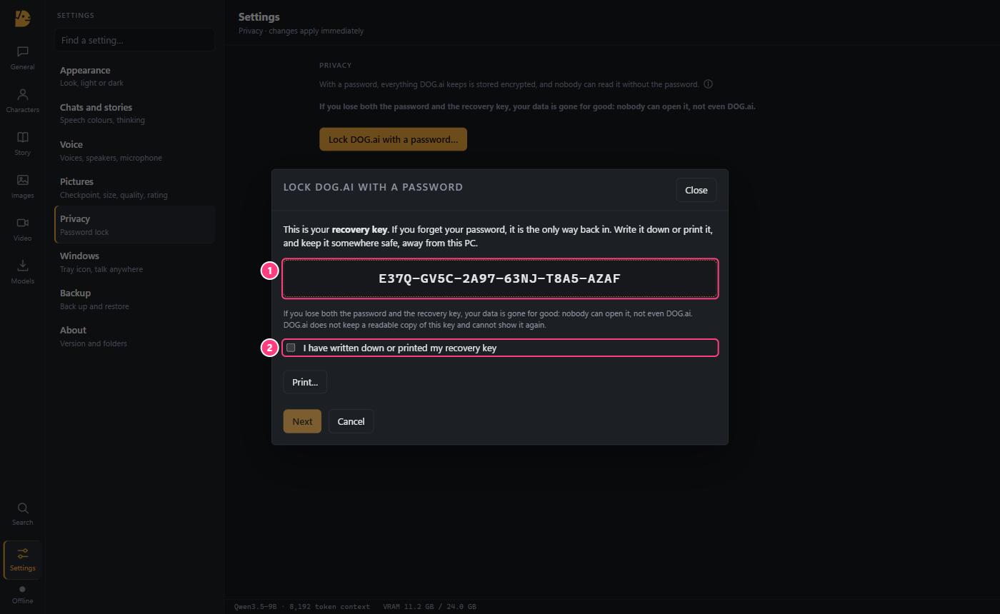
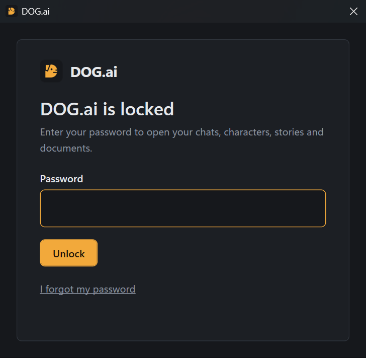
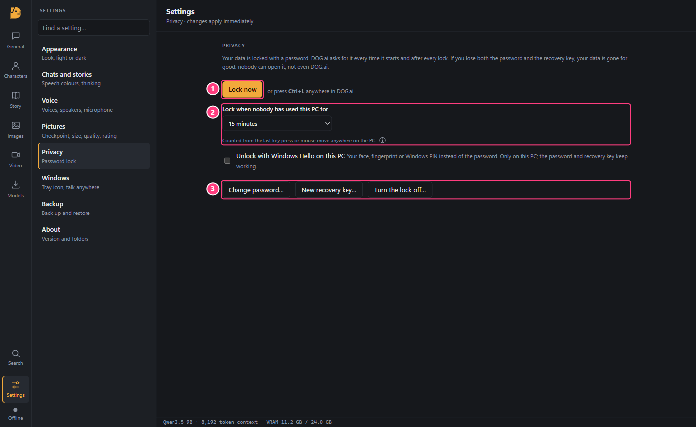
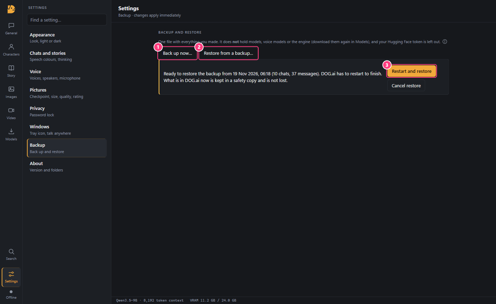

<!-- covers: settings/privacy, settings/backup -->
<!-- sources: src/DogAI.UI/Components/Library/{PrivacySettings,BackupSettings}.razor, src/DogAI.UI/Components/LockKey.razor, src/DogAI.Core/Privacy/**, src/DogAI.Core/Backup/**, src/DogAI.App/Lock* -->
# Privacy and backups

## What stays on this PC

Everything. Your chats, characters, stories, documents, pictures and videos are kept in DOG.ai's `data` folder, and
the models run on your own PC. DOG.ai has no account and sends nothing about you anywhere.

It is offline unless you press **Go online** in the Models section, and then it talks only to Hugging Face and GitHub,
to look up and download models and engines. It goes offline again by itself when you leave the Models section, or,
if a download is still running then, when the last one finishes.
**Settings** › **About** shows whether it is online, and counts any connection DOG.ai itself refused.

Without a lock, the `data` folder is ordinary files: anyone who can use this PC, or gets a copy of the folder, can
read them. The lock below closes that.

## Lock your data with a password

In **Settings** › **Privacy**, press **Lock DOG.ai with a password…** and choose a password of at least 8 characters.
A few unrelated words make a strong password you can remember.

DOG.ai then shows your **recovery key** (1), six groups of letters and digits:

**The recovery key is the only way back in if you forget the password.** Write it down, or press **Print…**, and keep
it away from this PC. DOG.ai keeps no readable copy and cannot show it again. Tick the box (2), press **Next**, and
type two of its groups to prove it was written down correctly. Then press **Lock my data and restart**.

> If you lose both the password and the recovery key, your data is gone for good: nobody can open it, not even DOG.ai.

DOG.ai restarts and asks for the new password. Your data is encrypted when you enter it, which can take up to a
minute. Until then nothing has changed, and **Don't lock my data after all** backs out.

What the lock covers: chats, characters, stories, documents, kept pictures and videos, and settings. They cannot be
read on this PC without the password, nor from a copy of the folder, nor from a backup. Models are not encrypted; they
are public downloads. Files you save yourself (a picture, a story, a chat saved as markdown) are ordinary files
outside the lock, and DOG.ai says so the first time you save one.

## The lock screen

From now on DOG.ai opens with this, and nothing else runs until you unlock it:

- Type the password and press **Unlock**.
- **I forgot my password** asks for the recovery key and a new password. The recovery key keeps working afterwards.
- After five wrong tries you must wait before the next one: 30 seconds, then a minute, then five minutes each time.
  Nothing is ever deleted, however often a wrong password is entered.

On a PC with **Windows Hello**, the first unlock offers to set it up: after that your face, fingerprint or Windows PIN
opens DOG.ai on this PC (**Use Windows Hello** on the lock screen). The password and the recovery key keep working,
and other PCs are not affected.

## While DOG.ai is locked with a password

**Settings** › **Privacy** now looks like this:

1. **Lock now** closes everything and shows the lock screen. So does **Ctrl+L**, anywhere in DOG.ai. With the icon
   near the clock turned on (**Settings** › **Windows**), its menu has **Lock now** too.
2. **Lock when nobody has used this PC for** 5, 15 or 30 minutes, 1 hour, or Never. It starts at 15 minutes and counts
   from the last key press or mouse move anywhere on the PC. While a reply is being written or read aloud, or a model
   is downloading, it waits up to the same time again. Locking unloads the model; a download that was cut carries on
   with **Resume** in Models.
3. **Change password…**, **New recovery key…** (the old one stops working) and **Turn the lock off…**, each of which
   asks for the current password. Turning the lock off restarts DOG.ai and stores your data as plain files again.

**Unlock with Windows Hello on this PC** is shown on a PC that has Windows Hello.

## Back up

**Settings** › **Backup** › **Back up now…** (1) saves one zip file with everything you made: chats, stories,
characters and their pictures, documents, kept pictures and videos, voices, styles, assistants, prompts and settings.
Keep it on another drive.

A backup does **not** hold models, voice models or the engines (download them again in Models), and it leaves out your
Hugging Face token.

A backup made while the lock is on is itself locked: it opens only with the password it was made with, or with the
recovery key. A backup made without the lock is a plain file that anyone can open.

## Restore, or move to another PC

1. Press **Restore from a backup…** (2) and choose the zip. For a locked backup, type its password or recovery key
   and press **Open backup**.
2. DOG.ai says which backup is ready. Press **Restart and restore** (3), or **Cancel restore** to leave everything as
   it is.

A restore replaces what DOG.ai holds now with what is in the backup. What it held is kept in a safety copy first, and
**Settings** › **Backup** says where that copy is. Settings that belong to the PC (where the models folder is, the
microphone and speakers, the Hugging Face token) stay as they are on this PC.

A locked backup restored into a DOG.ai without a lock brings its lock with it: from then on DOG.ai asks for that
backup's password. A backup restored into a locked DOG.ai is kept under the lock DOG.ai already has.

To move to another PC, back up here, set DOG.ai up there ([Install and set up](install.md)) and restore the backup.
Because DOG.ai is portable, you can also close it and copy its whole folder, models and all.

[Back to the contents](README.md)
