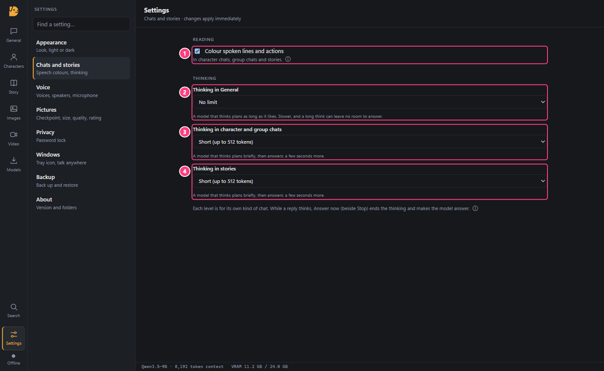
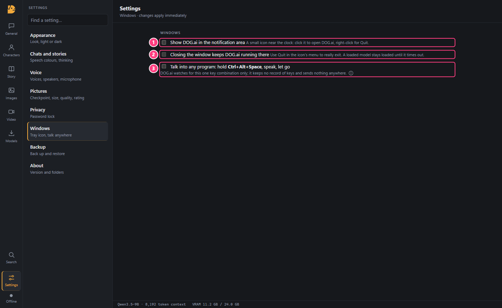
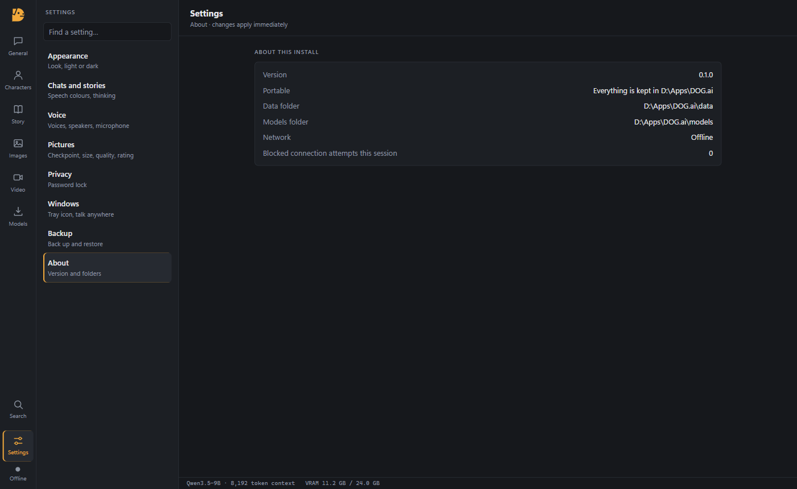

<!-- covers: settings, settings/chats, settings/windows, settings/about -->
<!-- sources: src/DogAI.UI/Pages/Settings.razor, src/DogAI.UI/Components/Library/WindowsSettings.razor, src/DogAI.Core/Settings/SettingsCatalog.cs, src/DogAI.Core/Chat/ThinkingLevel.cs -->
# Settings, keys and when something goes wrong

## Settings

**Settings** lists its eight parts on the left. Every change applies at once; there is no Save button. The box above
the list finds a setting by name, and so does Ctrl+K.

Settings holds what applies everywhere. What belongs to one chat (its style, instructions, persona, documents) is in
that chat's side panel, and which model does which job is in **Models › On this PC › Chat models**.

### Appearance

- **Look:** Workbench, Fireside or Playhouse.
- **Light or dark:** Match Windows, Dark or Light.

Both are shown in [Finding your way](finding-your-way.md#the-three-looks).

### Chats and stories

1. **Colour spoken lines and actions:** in character chats, group chats and stories, "quoted speech" takes a colour
   and *actions* are toned down; in a group chat each member speaks in their own colour. General chats are never
   coloured.
2. **Thinking in General**
3. **Thinking in character and group chats**
4. **Thinking in stories**

Some models think silently before they write. Each of the three lists says how long they may, for its own kind of
chat:

| Level | What it does |
|---|---|
| **Off** | Models that think answer at once. |
| **Short** (up to 512 tokens) | The model plans briefly, then answers: a few seconds more. |
| **Normal** (up to 1,536 tokens) | Room to plan; the answer starts later. |
| **Long** (up to 4,096 tokens) | It may plan at length; the answer can take most of a minute to start. |
| **No limit** | It plans as long as it likes. Slower, and a long think can leave no room to answer. |

General starts at No limit, the other two at Short. When thinking reaches its limit it is cut and the model goes on to
its answer; the reply says so in small type. While a reply thinks, **Answer now** beside **Stop** ends the thinking.
Models that do not think are not affected.

### Voice

**Default voice**, **Speaking speed**, **Speakers**, **Microphone**, **Read replies aloud**, **Language you speak**,
**Hands-free listening** and **Speech recognition** are explained on the [Voice](voice.md#settings--voice) page.

### Pictures

**Checkpoint**, **Quality to start at**, **Start pictures at**, **Rating pictures aim for** and
**Show me the prompt before drawing** are explained on the [Images](images.md#settings--pictures) page.

### Privacy

**Lock with a password:** everything DOG.ai keeps is stored encrypted and it asks for the password at every start.
See [Privacy and backups](privacy-and-backups.md).

### Windows

All three are off until you turn them on.

1. **Show DOG.ai in the notification area:** a small icon near the clock. Click it to open DOG.ai; right-click it
   for **Open DOG.ai** and **Quit**.
2. **Closing the window keeps DOG.ai running** there (it needs the icon). The window's × then only hides it, and a
   loaded model stays loaded until it times out; **Quit** in the icon's menu really exits.
3. **Talk into any program:** hold **Ctrl+Alt+Space**, speak, let go, and what you said is typed where your cursor
   is, in whatever program has the focus. It needs a speech model (**Models › Get models › Voice**). DOG.ai watches
   for this one key combination only and keeps no record of keys.

### Backup

**Back up and restore:** one file with everything you made, and how to bring it back. See
[Privacy and backups](privacy-and-backups.md#back-up).

### About

**About this install** shows the version, where DOG.ai keeps its data and its models, whether it is online, and how
many connections it refused since it started:

## Keys

| Key | Where | What it does |
|---|---|---|
| **Enter** | The box you type in | Sends the message. |
| **Shift+Enter** | The box you type in | Starts a new line. |
| **Ctrl+K** | Anywhere | Opens the jump box: screens, chats, characters, stories, settings. Again closes it. |
| **↑ ↓**, **Enter** | The jump box | Choose a result and open it. |
| **Escape** | Anywhere | Closes what is open on top: a dialog, a menu, the jump box, the side panel on a small window. |
| **Ctrl+L** | Anywhere, with the password lock on | Locks DOG.ai. |
| **Ctrl+Space** (hold) | The box you type in, with a speech model | Listens while you hold it and writes down what you said. |
| **Ctrl+Alt+Space** (hold) | Any program, once turned on in **Settings** › **Windows** | Types what you say where the cursor is. |
| **Ctrl+Enter** | **Write it for me…** in Images and Video | Writes the prompt from your words. |

## When something goes wrong

**The box says "Load a model to start chatting."** No model is in memory. Click the model button at the top right of
the chat and pick one, or set a default for the place in **Models › On this PC › Chat models** so it loads by itself.
With no model on the PC yet, see [Install and set up](install.md).

**Chat engine says "Not found".** The chat engine is not installed: **Models › Engines**, **Go online**, **Check for
updates**, **Install** ([Install and set up](install.md#3-get-the-chat-engine)).

**Windows asks whether to run DOG.ai, or says it protected your PC.** The zip was not unblocked before unzipping
([Install and set up](install.md#1-download-and-unzip)).

**A reply shows only thinking, with "No answer".** The model's thinking used up the room it had. The note under it
says what to change: a shorter level for that kind of chat (above), or a larger **Context size** in
**Models › On this PC › Chat models**. Then press **Regenerate**.

**A reply stops in the middle.** Press **Continue** under it.

**"What was sent needs … tokens, and the model was loaded with room for …".** The message with its pictures is larger
than the model's context. Send fewer pictures or a shorter message, or choose a larger **Context size**.

**A long chat forgets how it began.** A model sees only as much as its context size holds (the status bar shows it),
so the oldest messages are no longer sent; they stay in the chat. A larger **Context size** sends more. Character
chats, group chats and stories keep a summary of the older part under **Memory** in the side panel.

**Replies are slow.** The model's row in **Models › On this PC › Chat models** says how it fits. **Partly on GPU**
means part of it runs from the PC's own memory, which is much slower: choose a smaller version of the model or a
smaller **Context size**. Thinking also takes time: see the levels above.

**The graphics card is full, or another program needs it.** **Unload everything** in the Models side panel frees
DOG.ai's share of the card. Models load again when you next use them.

**A download failed or stopped.** Open **Downloads** at the top of Models. **Retry** or **Resume** carries on from
where it was; press **Go online** first if DOG.ai is offline. A model that asks you to
accept its terms on Hugging Face needs a **Hugging Face token**, in the side panel of **Models › Get models**.

**No microphone buttons.** They appear once a speech model is on this PC: **Models › Get models › Voice**.

**"The picture engine is not installed yet."** Install it in **Models › Engines**. If pictures stopped working after
they once did, **Install again** there replaces a damaged copy.

**A video cannot be made, or Better is not offered.** The Video page says why: the graphics card or the PC's free
memory is too small for it at the moment. Closing other programs that use the card helps
([Video](video.md)).

**You forgot the password.** **I forgot my password** on the lock screen takes the recovery key
([Privacy and backups](privacy-and-backups.md#the-lock-screen)). Without the password and the recovery key the data
cannot be opened by anyone.

**Something else.** DOG.ai writes a log for each day into the `logs` folder inside its data folder
(**Settings** › **About** shows where that is): `DOG.ai-<date>.log`. Its last lines usually say what failed. If you
pass a log on to someone, read it first: it can name your folders and model files.

[Back to the contents](README.md)
