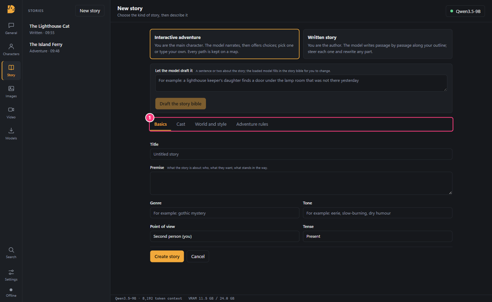
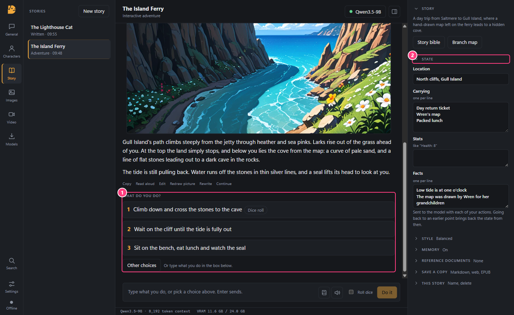
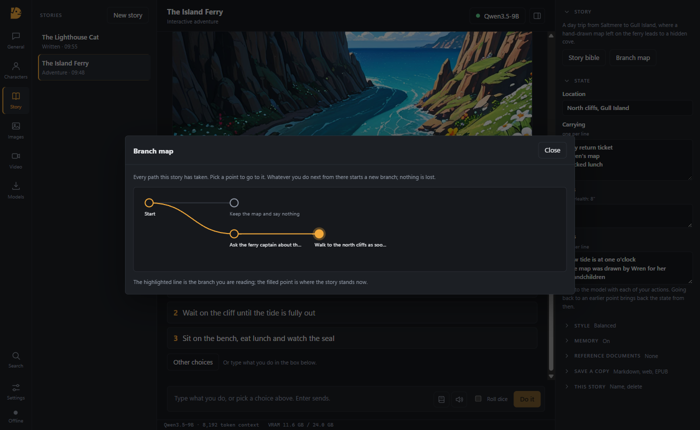
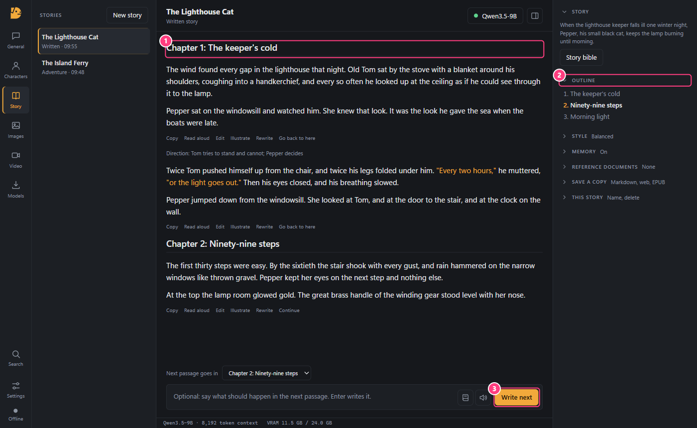

<!-- covers: story, story/new -->
<!-- sources: src/DogAI.UI/Pages/{Story,StoryEditor}.razor, src/DogAI.UI/Components/Stories/**, src/DogAI.Core/Stories/** -->
# Stories

**Story** is for longer fiction with the model. There are two kinds:

- **Interactive adventure:** you are the main character. The model narrates, then offers choices; pick one or type
  your own. Every path is kept on a map.
- **Written story:** you are the author. The model writes passage by passage along your outline; you steer each one
  and rewrite any part.

## Start a story

**New story** at the top of the list opens the story bible: what the model follows for every passage.

Choose the kind at the top. **Draft the story bible** fills in the tabs from a sentence or two of yours, with the
model in memory; read them through and change what you like. Or fill them in yourself (1):

- **Basics:** the title, the premise (who, what they want, what stands in the way), genre, tone, point of view and
  tense.
- **Cast:** character cards from your [Characters](characters.md) list, given to the model with every passage, and
  the people of the story in your own words. In an adventure, one card can be the one you play. A card stays linked:
  editing it later changes the story too.
- **World and style:** the setting, and how the prose should read.
- **Adventure rules** (adventures): keep track of location, things carried, stats and facts, and decide risky actions
  with a 20-sided dice. **Outline** (written stories): the chapters, in order.

**Create story** saves it. A character's page has **Start a story**, and a character chat has **Turn into a story**,
which starts an adventure that carries on from the chat; the chat stays as it is.

## Play an adventure

An adventure starts with **Begin the story**. After each passage the model offers choices (1). Click one, or type what
you do in the box and press **Do it**. A choice marked **Dice roll** could go wrong: a dice decides, and the narrator
follows the result. **Other choices** asks for new ones.

**State** (2) is what the story keeps track of: where you are, what you carry, stats and facts. The model updates it
after each passage, and you can correct it; it is sent with each of your actions.

Under each passage:

- **Rewrite** writes the passage again; the earlier version is kept.
- **Continue** carries on the last passage, **Edit** changes its text.
- **Illustrate** draws a picture of the passage, shown above it (here, the cliffs); **Redraw picture** draws another.
  It needs the picture model (see [Images](images.md)).
- **Go back to here** returns to an earlier moment to choose again. The path you took stays on the map.

**Branch map** in the side panel shows every path the story has taken. The highlighted line is the branch you are
reading; click any point to go to it.

## Write a story

A written story moves along its outline. Press **Write next** (3) for the next passage, after saying in the box what
should happen in it if you like. **Next passage goes in** chooses the chapter; each chapter starts with its heading
(1), and **Outline** in the side panel (2) shows where the story stands.

Select some text in a passage and a bar offers **Rewrite**, **Expand**, **Shorten**, **Change tone…** and
**Other…**: the model writes a replacement for that part only, and nothing changes until you press **Use this**.

## Everything else in the side panel

- **Story bible** opens the bible again to change it.
- **Style** is how freely the model writes, as in [General](general-chat.md).
- **Memory** summarises earlier passages when the story outgrows what the model can see at once, and can find
  earlier passages that matter to what happens next.
- **Reference documents** gives the story files to draw on, such as notes about its world (see
  [Documents](documents.md)).
- **Save a copy** writes the branch on screen as **Markdown**, a **Web page**, or an **EPUB** e-book, with its
  pictures in the last two.
- **This story** renames or deletes it.

[Back to the contents](README.md)
