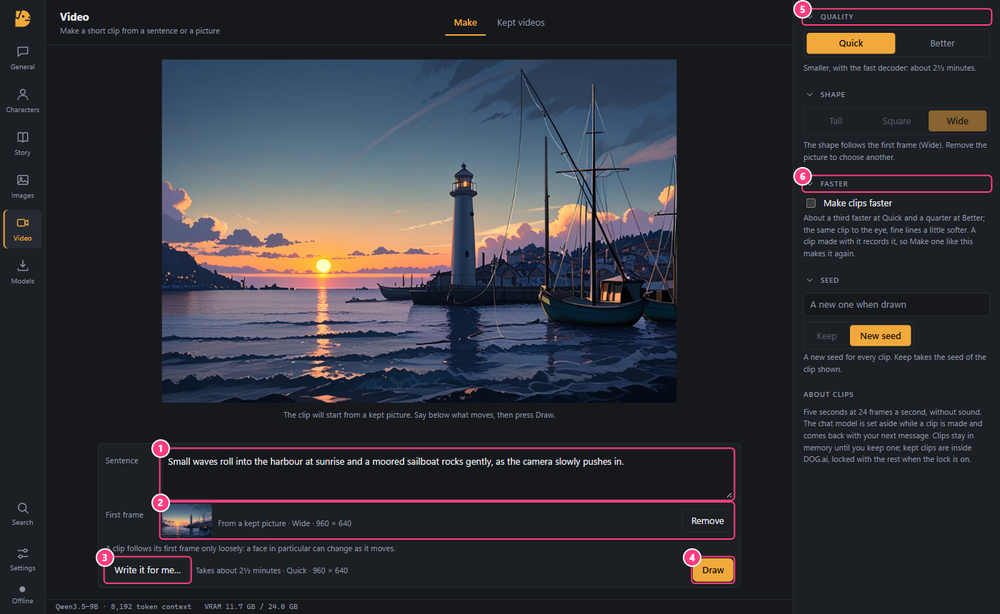
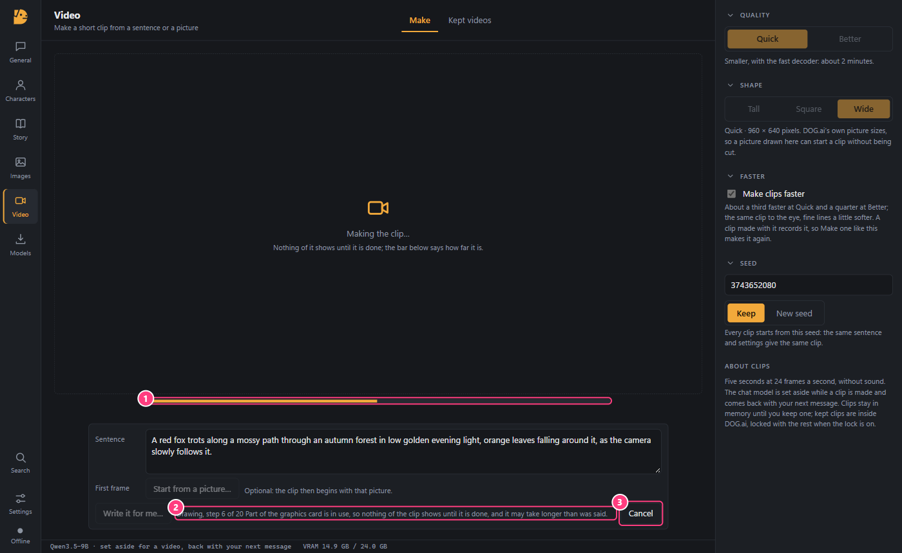
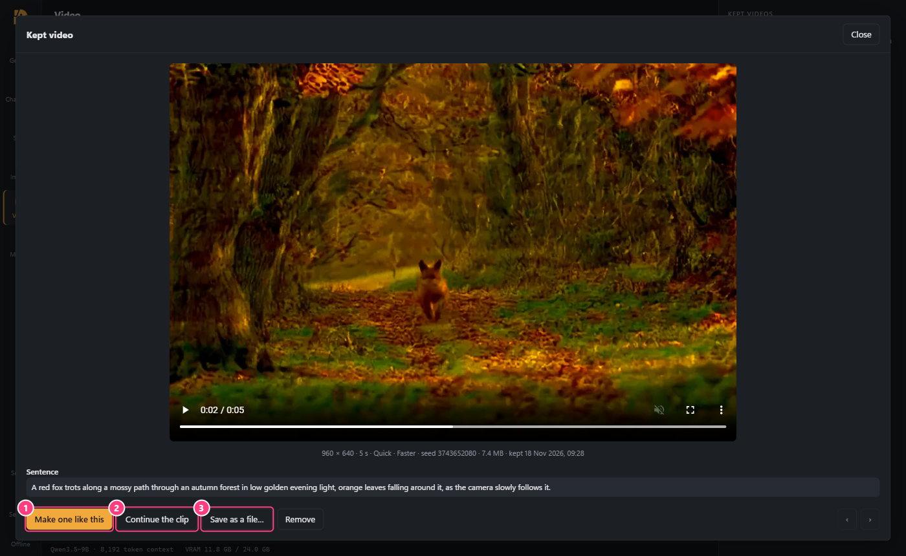

<!-- covers: video, video/kept -->
<!-- sources: src/DogAI.UI/Pages/VideoMake.razor, src/DogAI.UI/Components/Video/**, src/DogAI.Core/Video/** -->
# Video

**Video** makes short clips on your own graphics card: five seconds at 24 frames a second, without sound, from a
sentence, or from a sentence and a picture to start from. It uses the video model (Wan 2.2 TI2V-5B), four files that
**Models › Get models › Video** downloads together (see [Models](models.md)). While a clip is made the chat model is
set aside; it comes back with your next message.

## Make a clip

1. **Sentence:** what the clip shows and what moves, in plain sentences (not tags), and how the camera moves if you
   like: "Small waves roll into the harbour at sunrise and a moored sailboat rocks gently, as the camera slowly pushes
   in."
2. **First frame** (optional): the clip begins with this picture. **Start from a picture…** opens a picture file;
   **Animate…** on a picture elsewhere in DOG.ai brings it here (a picture in Images or Kept pictures, a character's or
   a persona's portrait, a picture in a chat or a story). A picture of another shape is cut to the nearest of Tall,
   Square and Wide. **Remove** lets it go. A clip follows its first frame only loosely: a face in particular can
   change as it moves.
3. **Write it for me…** has the chat model write the sentence (see below).
4. **Draw** makes the clip. The line beside it says about how long that takes on this PC.
5. **Quality:** **Quick** is smaller and uses the fast decoder; **Better** is larger and sharper, uses the model's own
   decoder and takes about three times as long. The line under them gives the time on this PC.
6. **Faster:** **Make clips faster** makes a clip about a third faster at Quick and a quarter at Better; the same clip
   to the eye, with fine lines a little softer.

**Shape** is Tall, Square or Wide; with a first frame it follows the picture. **Seed** works as it does for pictures:
empty, every clip is new; the same seed, sentence and settings make the same clip again.

### While it is made

The bar (1) and the line beside the buttons (2) say how far it has come, and **Cancel** (3) stops it. Leaving the Video
page stops it too. At Quick on a free graphics card the clip shows as it forms. When part of the card is in use by
other programs, as here, DOG.ai keeps more of the video model in the PC's own memory instead, and nothing of the clip
shows until it is done; the line says so.

While a clip is made the graphics card is used for nothing else: document search and speech recognition carry on on
the processor, more slowly, and the line under the box says so.

### A finished clip

The clip plays where the picture was, and goes into the strip beside it with the other clips of this session (the
last four are held). Under it:

- **Keep** keeps it inside DOG.ai, under **Kept videos**. Clips you do not keep are gone when DOG.ai closes.
- **Continue the clip** starts the next clip from this clip's last frame, with the same sentence for you to change.
- **Use this seed** makes the next clip from this clip's seed.
- **Save as a file…** saves it as a WebM video.

## Longer videos: continue and join

A clip is five seconds. To go on, press **Continue the clip**: its last frame becomes the next clip's first frame.
Change the sentence to say what happens next, or the clip repeats the same motion, and press **Draw**.

When that clip is done it has **Join with the clip before**: the two become one video of ten seconds, added to the
strip as a new clip beside them (the two stay as they are). A third clip can be joined the same way, to fifteen
seconds; that is the most one video holds. At each join the picture softens in one step and jumps a little, and each
continued clip is a little softer than the one before and drifts further from the first picture: after two it shows.

Join works for clips made in the same session, and for a clip continued from a kept video. DOG.ai does not remember
which clip continued which once it closes, so join before you close it.

## Write it for me

**Write it for me…** asks the chat model for the sentence. **From words:** say in a few words what should happen.
**From the first frame:** the model looks at the picture held as the first frame and says what could move; add what
should happen if you like. It writes one to three sentences (what is seen, what moves and how the camera moves), which
you read first: **Use this sentence** puts it in the box, where you can change it before pressing **Draw**. It uses
the chat model in memory, else the default for General; from a picture it needs one that can see pictures.

## Kept videos

**Kept videos** shows every clip you kept, newest first. Click one to play it:

1. **Make one like this** puts its sentence, quality, shape, seed and first frame (if it had one) back on the Make tab:
   **Draw** makes the same clip again.
2. **Continue the clip** starts the next clip from its last frame, on the Make tab. That clip can be joined to it.
3. **Save as a file…** saves it as a WebM video.

**Remove** deletes it from DOG.ai; it cannot be brought back. A joined video says so in its facts ("10 s · 2 clips
joined"); its sentence, seed and first frame are its last clip's, and Make one like this makes only that last clip
again. Kept videos are inside DOG.ai and are locked with the rest when the lock is on (see
[Privacy and backups](privacy-and-backups.md)).

## On a smaller graphics card

Quick clips need a card with 8 GB or more, Better about 16 GB free. On a card that cannot make Better, the Quality
part says why and offers Quick only. On cards under 24 GB, most of the video model is kept in the PC's own memory
(about 12 GB of free RAM) while a clip is made, and nothing of the clip shows until it is done.
**Models › Get models › Video** says before you download whether the model fits this PC.

[Back to the contents](README.md)
