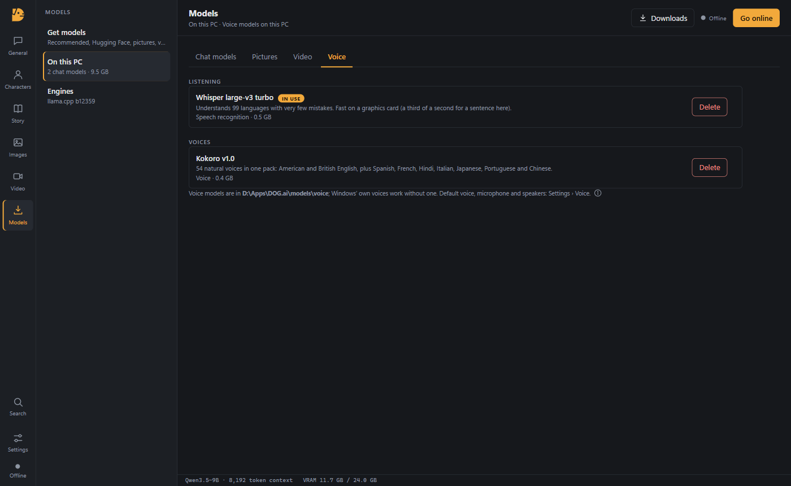
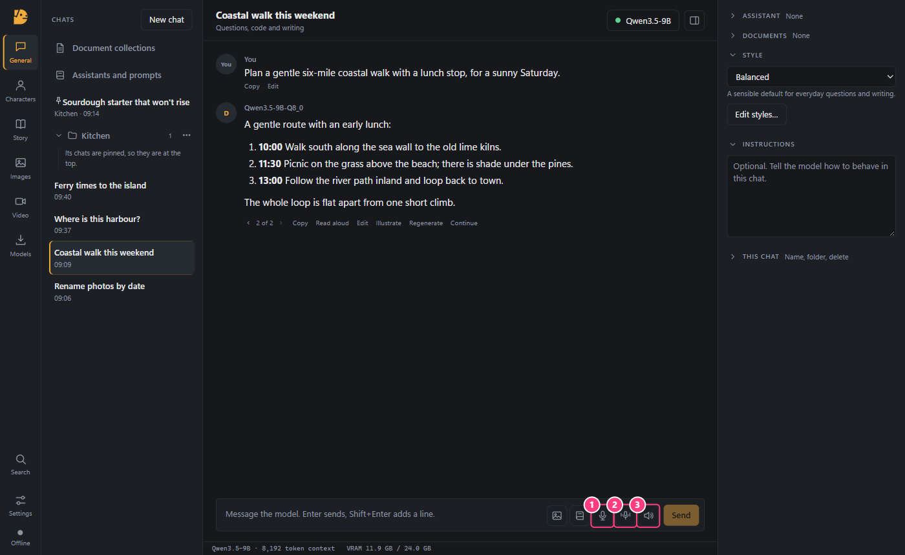
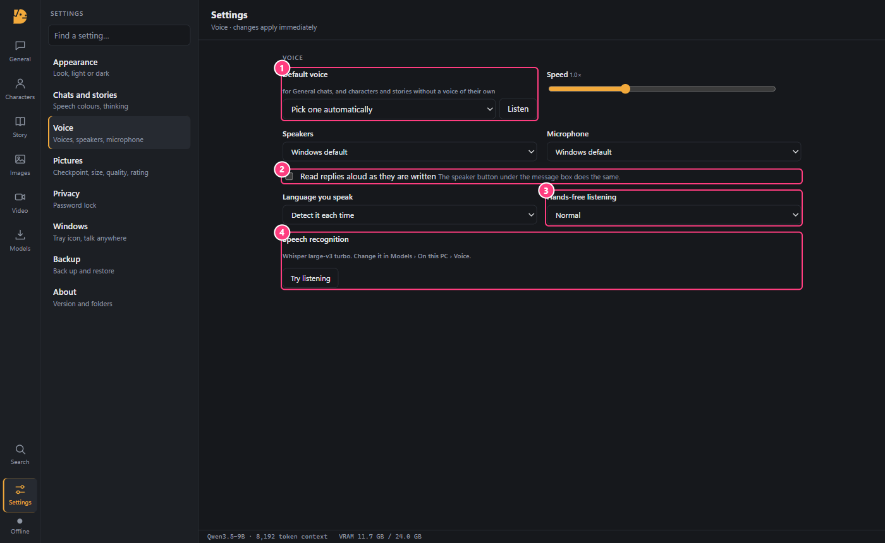
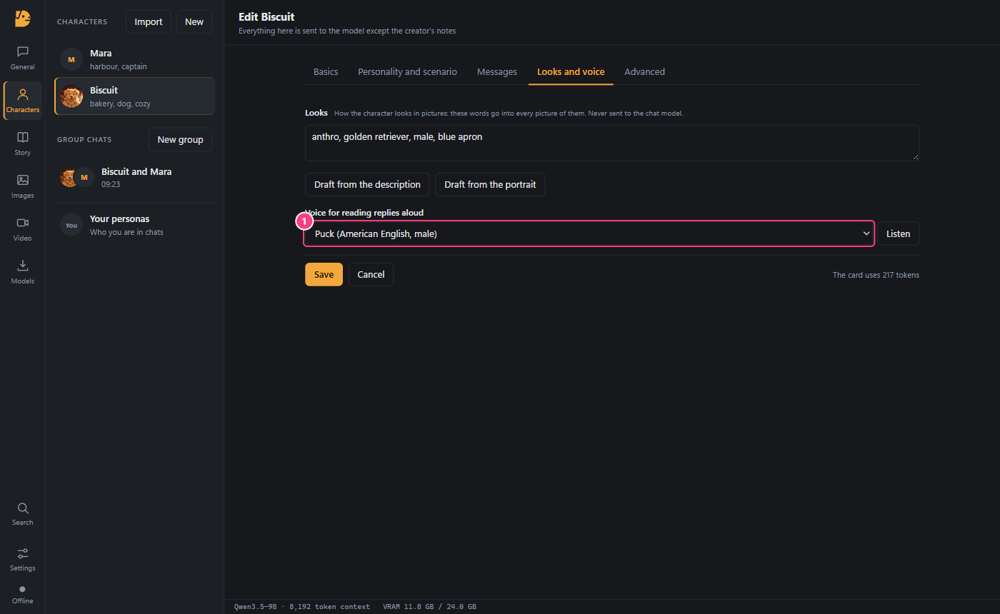

<!-- covers: settings/voice -->
<!-- sources: src/DogAI.UI/Components/Voice/**, src/DogAI.UI/Components/VoicePicker.razor, src/DogAI.UI/Components/Chat/ReadAloudButton.razor, src/DogAI.Core/Voice/** -->
# Voice

DOG.ai can listen and speak. You can talk instead of typing, have a chat go back and forth by voice, and have replies
read aloud, each character in a voice of its own. Listening and speaking run on this PC; nothing you say or hear
leaves it.

## Voice models

Reading aloud works from the start with Windows' own voices. Two kinds of download do more, both in
**Models › Get models › Voice**:

- **Listening:** a speech recognition model turns what you say into text. **Whisper large-v3 turbo** is the best pick
  (99 languages, fast on a graphics card); **Whisper small** and **Whisper base (English only)** are lighter.
  Without one, the microphone buttons are not shown.
- **Voices** that sound far more natural than Windows' own: **Kokoro v1.0** (54 voices: American and British English,
  Spanish, French, Hindi, Italian, Japanese, Portuguese and Chinese) and a few single **Piper** voices. They run on the
  processor.

What is installed is in **Models › On this PC › Voice**, where **Delete** removes a model:

## Talk in a chat

1. **The microphone:** click it and speak, then click it again ("Done talking: write it down"). What you said appears
   in the box for you to read and change before you send it. Or hold **Ctrl+Space** while you speak.
2. **Hands-free:** talk, pause, and it is sent. It does not listen while the reply is written (or read aloud, with the
   speaker on), then listens again, so a chat can go back and forth by voice. Click it again to stop.
3. **The speaker:** read every reply aloud as it is written. **Read aloud** under a message reads that one.

The same buttons are in character chats, group chats and stories.

## Settings › Voice

1. **Default voice:** the voice for General chats, and for characters and stories without a voice of their own.
   "Pick one automatically" chooses for you. **Listen** plays a sample, and **Speed** sets how fast voices speak.
2. **Read replies aloud as they are written:** the same as the speaker button.
3. **Hands-free listening:** how easily hands-free hears you. **Noisy room** takes only clear, loud speech; **Quiet
   room** picks up soft voices.
4. **Speech recognition:** the model that listens, with **Try listening** to check the microphone.

**Speakers** and **Microphone** choose the devices ("Windows default" follows Windows). **Language you speak** is
"Detect it each time" unless you choose one.

To talk into any other program on the PC, turn on **Talk into any program** in **Settings** › **Windows**: hold
**Ctrl+Alt+Space**, speak, let go, and the words are typed where the cursor is.

## A voice for each character

A character's own voice is chosen in its editor, on **Looks and voice**, under **Voice for reading replies aloud**
(1); **Listen** plays it.

In a group chat each reply is read in its speaker's voice. A story's narrator voice is chosen in the story bible, on
**World and style**, and in a story the lines a character says in quotes are read in that character's voice.

[Back to the contents](README.md)
